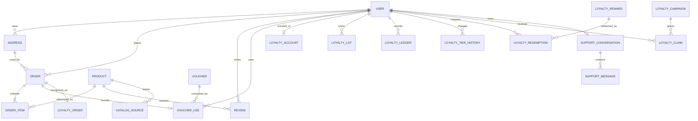
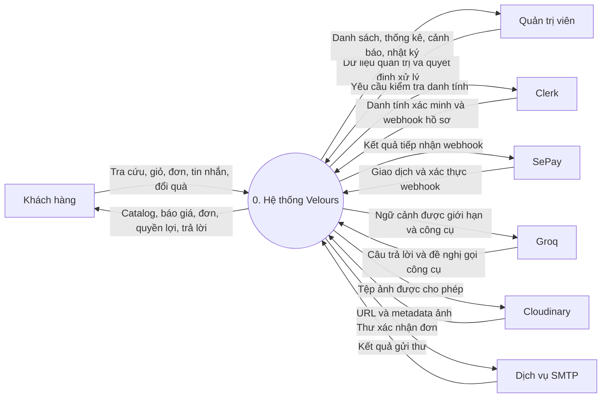
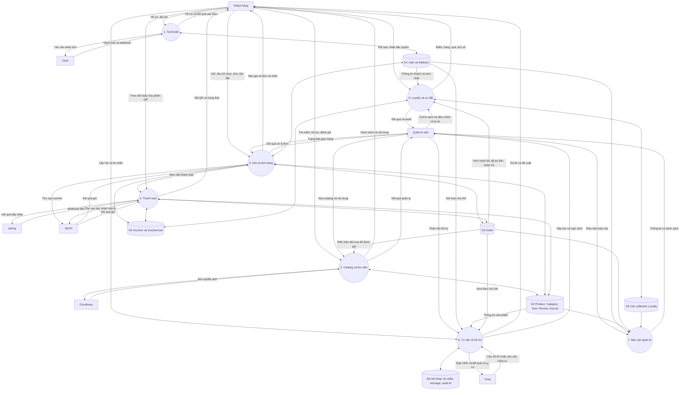
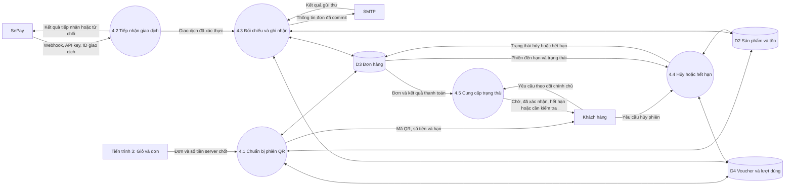
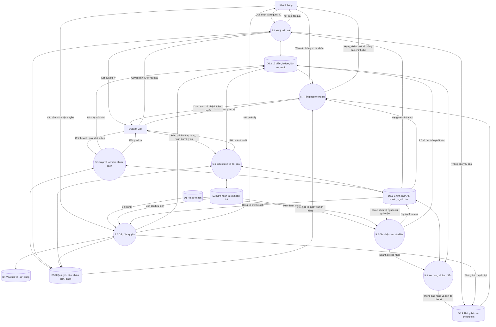
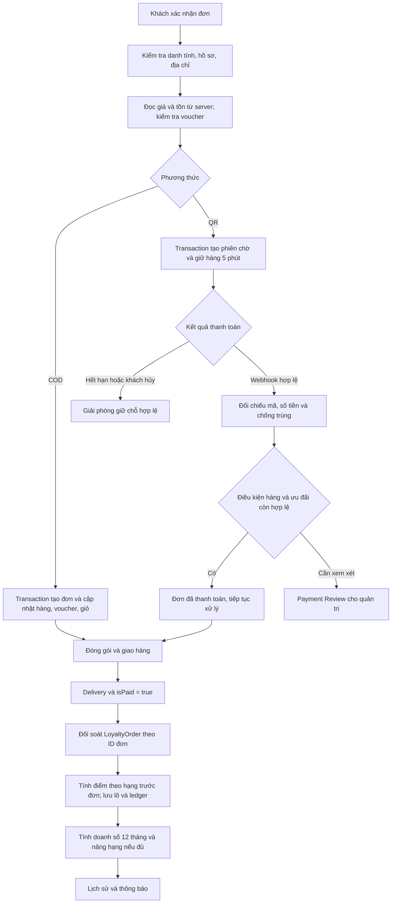
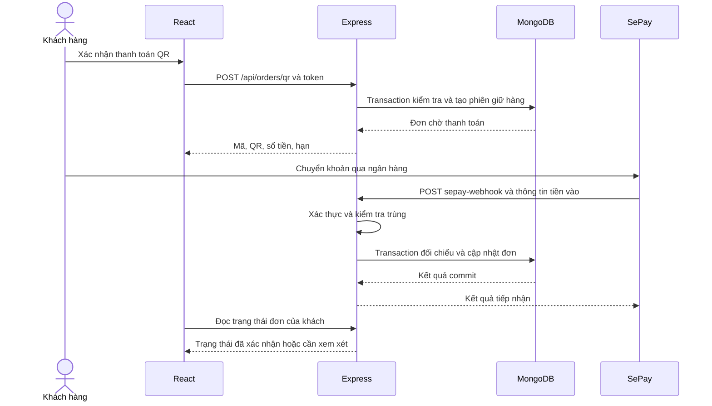
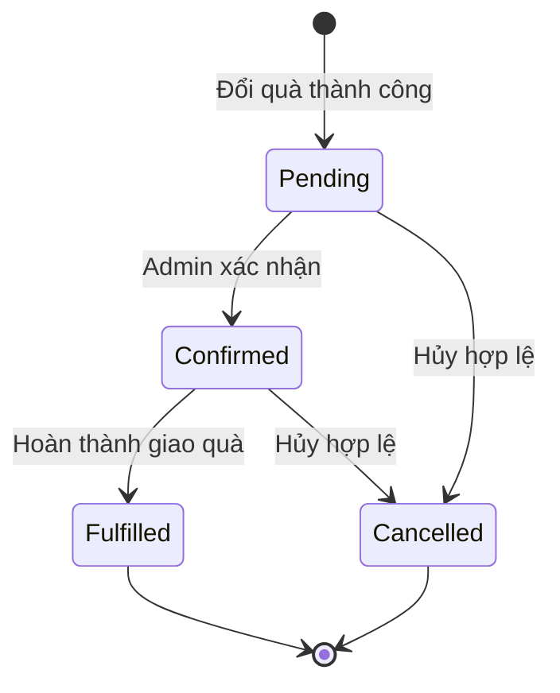
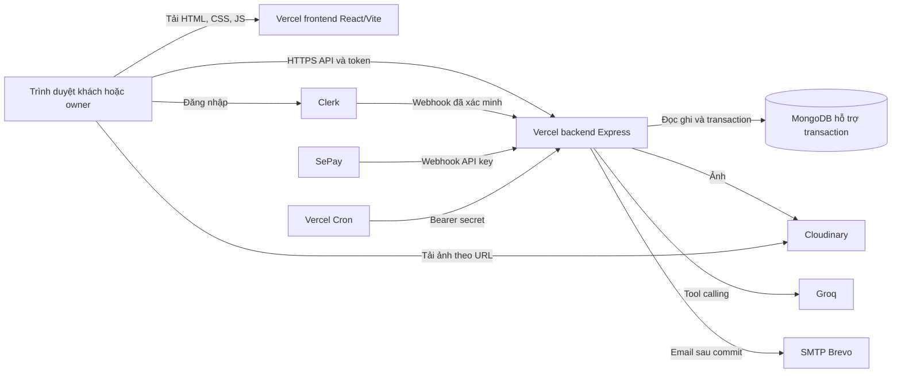

# HỌC VIỆN CÔNG NGHỆ BƯU CHÍNH VIỄN THÔNG
## KHOA CÔNG NGHỆ THÔNG TIN 1

---

# BÁO CÁO BÀI TẬP LỚN
## MÔN PHÁT TRIỂN HỆ THỐNG THƯƠNG MẠI ĐIỆN TỬ

### Đề tài: Xây dựng website thương mại điện tử nước hoa Velours

| Thông tin | Nội dung |
|---|---|
| Lớp | [Cần bổ sung] |
| Số thứ tự nhóm | [Cần bổ sung] |
| Giảng viên hướng dẫn | TS. Lê Văn Vịnh — theo mẫu báo cáo được cung cấp |
| Nhóm trưởng | **[Cần bổ sung họ tên và mã sinh viên]** |
| Thành viên | [Cần bổ sung danh sách thực tế] |
| Tên sản phẩm | Velours |
| Website triển khai | <https://velours-jet.vercel.app> |
| API triển khai | <https://vouges-backend.vercel.app> |
| Thời điểm lập báo cáo | 03/11/2026 |

**HÀ NỘI, THÁNG 11 NĂM 2026**

---

## Thông tin biên soạn

Báo cáo được lập theo cấu trúc của [Template BTL PTHT TMĐT.pdf](<Template BTL PTHT TMĐT.pdf>), gồm bốn chương, kết luận, hướng phát triển, tài liệu tham khảo và phân công công việc. Số thứ tự mục hình thức thanh toán trong mẫu bị lặp; báo cáo chuẩn hóa thành mục 4.3.10.

Nội dung kỹ thuật được đối chiếu với mã nguồn trong `client/`, `server/`, `tools/`, các tệp dữ liệu còn phục vụ kiểm thử và nhật ký kiểm tra tại thời điểm lập báo cáo. Những phần đã có giao diện nhưng chưa có xử lý nghiệp vụ được ghi rõ. Các sơ đồ thể hiện thiết kế rút ra từ triển khai; không được hiểu là ảnh chụp màn hình hoặc kết quả khảo sát người dùng thực địa.

Các thông tin lớp, thành viên, mã sinh viên và phân công chưa được cung cấp nên được đánh dấu **[Cần bổ sung]**. Báo cáo không đưa khóa API, chuỗi kết nối cơ sở dữ liệu, mật khẩu, số tài khoản thanh toán thực tế hoặc thông tin cá nhân của khách hàng vào tài liệu.

## Mục lục

1. [Chương I. Mô tả, khảo sát và xác định yêu cầu bài toán](#chuong-1)
2. [Chương II. Kiến thức áp dụng](#chuong-2)
3. [Chương III. Phân tích thiết kế hệ thống](#chuong-3)
4. [Chương IV. Cài đặt và hướng dẫn sử dụng](#chuong-4)
5. [Kết luận](#ket-luan)
6. [Hướng phát triển](#huong-phat-trien)
7. [Tài liệu tham khảo](#tai-lieu-tham-khao)
8. [Phân công công việc](#phan-cong)
9. [Phụ lục: Đối chiếu báo cáo với mã nguồn](#phu-luc)

## Danh mục từ viết tắt

| Từ viết tắt | Ý nghĩa trong báo cáo |
|---|---|
| TMĐT | Thương mại điện tử |
| B2C | Doanh nghiệp bán hàng cho khách hàng cá nhân |
| BFD | Business Function Diagram — biểu đồ phân cấp chức năng |
| DFD | Data Flow Diagram — biểu đồ luồng dữ liệu |
| CSDL | Cơ sở dữ liệu |
| API / REST | Giao diện lập trình ứng dụng / cách tổ chức tài nguyên qua HTTP |
| SPA | Single Page Application — ứng dụng giao diện một trang |
| ODM | Object Document Mapper — ánh xạ đối tượng với tài liệu MongoDB |
| COD | Thanh toán khi nhận hàng |
| QR | Mã phản hồi nhanh, dùng để hỗ trợ chuyển khoản |
| RBAC | Phân quyền dựa trên vai trò |
| SSE | Server-Sent Events — luồng sự kiện từ máy chủ đến trình duyệt |
| FEFO | First Expired, First Out — dùng lô điểm hết hạn sớm nhất trước |
| Ledger | Sổ giao dịch ghi nhận các bút toán cộng, trừ và điều chỉnh |
| Idempotency | Xử lý lặp một yêu cầu mà không tạo tác động nghiệp vụ trùng |
| VIP | Nhóm khách hàng được áp dụng đặc quyền theo chính sách |

<a id="chuong-1"></a>
# CHƯƠNG I. MÔ TẢ, KHẢO SÁT VÀ XÁC ĐỊNH YÊU CẦU BÀI TOÁN

## 1.1. Mô tả bài toán

### 1.1.1. Bối cảnh và vấn đề cần giải quyết

Nước hoa là mặt hàng có nhiều thuộc tính ảnh hưởng đến quyết định mua: thương hiệu, giới tính, dung tích, nồng độ, nhóm hương, kiểu mùi và các note hương. Một sản phẩm có thể có nhiều dung tích với giá, hình ảnh và tồn kho khác nhau. Vì vậy, website chỉ hiển thị một ảnh và một mức giá cho mỗi sản phẩm chưa thể phản ánh đầy đủ nghiệp vụ bán hàng.

Ở phía cửa hàng, việc xử lý đơn bằng phương pháp thủ công có thể gây sai lệch giá theo dung tích, bán vượt tồn, nhận nhầm giao dịch chuyển khoản hoặc ghi nhận ưu đãi trùng. Khi triển khai thành viên thân thiết, hệ thống còn phải phân biệt doanh số xét hạng với điểm thưởng, theo dõi thời hạn và điều chỉnh khi hoàn trả.

Đề tài xây dựng **Velours**, website TMĐT bán nước hoa theo mô hình B2C, kết hợp cửa hàng trực tuyến, thư viện kiến thức và khu vực quản trị. Trọng tâm là một quy trình xuyên suốt: khách tìm hiểu sản phẩm, chọn biến thể, đặt hàng, thanh toán, theo dõi giao hàng, đánh giá và nhận quyền lợi thành viên.

### 1.1.2. Mục tiêu tổng quát

Xây dựng hệ thống cho phép cửa hàng quản lý danh mục nước hoa và vận hành bán hàng trực tuyến, đồng thời cung cấp trải nghiệm tìm kiếm, thanh toán, tư vấn và chăm sóc khách hàng nhất quán.

### 1.1.3. Mục tiêu cụ thể

1. Hiển thị sản phẩm theo danh mục, thương hiệu và thuộc tính hương; hỗ trợ lọc, sắp xếp, phân trang và tìm kiếm.
2. Quản lý biến thể dung tích với giá, ảnh, trạng thái bán và số lượng riêng.
3. Quản lý tài khoản, hồ sơ khách hàng, địa chỉ nhận hàng và giỏ hàng.
4. Tính lại tiền hàng, giảm giá, phí giao hàng và số tiền phải trả tại máy chủ.
5. Hỗ trợ COD và chuyển khoản QR; xác minh thanh toán bằng webhook SePay thay vì dựa vào thông báo từ trình duyệt.
6. Theo dõi vòng đời đơn và gửi email xác nhận sau khi giao dịch dữ liệu đã hoàn tất.
7. Xây dựng thư viện nhóm hương, kiểu mùi, note hương và liên kết với sản phẩm.
8. Cung cấp chatbot tư vấn có công cụ đọc dữ liệu thực tế và cơ chế xác nhận trước khi thay đổi giỏ hàng.
9. Hỗ trợ hội thoại khách hàng–nhân viên, thông báo chưa đọc và cập nhật bằng SSE.
10. Triển khai chương trình thành viên bốn hạng, điểm thưởng, đổi quà, chiến dịch đặc quyền và nhật ký quản trị.
11. Tách khu vực khách hàng và quản trị; kiểm tra quyền tại API.
12. Kiểm thử các quy tắc nghiệp vụ quan trọng và triển khai frontend/backend độc lập.

### 1.1.4. Phạm vi và giới hạn

| Thành phần | Phạm vi hiện có |
|---|---|
| Kênh bán | Website cho khách hàng cá nhân, một cửa hàng quản trị tập trung |
| Tiền tệ | VND, lưu giá trị tiền ở đơn vị đồng |
| Mặt hàng chính | Nước hoa nam, nữ, unisex; quản lý thương hiệu và thuộc tính hương |
| Biến thể | Dung tích, giá, ảnh và tồn kho theo biến thể |
| Thanh toán | COD và QR chuyển khoản qua SePay |
| Giao hàng | Lựa chọn phương thức, tính phí theo chính sách trong mã nguồn; chưa kết nối API hãng vận chuyển |
| Khách hàng | Tài khoản Clerk, hồ sơ, địa chỉ, giỏ hàng, đơn, đánh giá, thành viên và voucher |
| Quản trị | Catalog, thư viện, đơn hàng, doanh thu, khách hàng, mã giảm giá, loyalty, tin nhắn |
| Nội dung | Kiến thức về hương và trang giới thiệu/chính sách; không có một CMS độc lập cho mọi nội dung website |
| Ngoài phạm vi hiện tại | Sàn nhiều nhà bán, ERP, hóa đơn điện tử, ứng dụng di động riêng, thanh toán thẻ trực tiếp, hoàn tiền ngân hàng tự động |

## 1.2. Khảo sát, xác định yêu cầu bài toán

### 1.2.1. Phương pháp khảo sát

Phạm vi khảo sát của báo cáo gồm: phân tích yêu cầu do chủ dự án cung cấp; khảo sát các màn hình và luồng đã triển khai; đọc schema, route, controller, service; đối chiếu các bài kiểm thử. Dữ liệu catalog và thư viện có nguồn tham chiếu được lưu trong hệ thống. Chủ dự án đã xác nhận quyền đăng lại toàn văn nội dung nguồn cho thư viện.

Báo cáo **không giả định đã tiến hành phỏng vấn hoặc khảo sát định lượng**. Các nhu cầu dưới đây là yêu cầu dự án và phân tích nghiệp vụ, không phải kết quả điều tra thị trường có cỡ mẫu.

### 1.2.2. Tác nhân và nhu cầu

| Tác nhân | Nhu cầu | Giới hạn quyền |
|---|---|---|
| Khách vãng lai | Xem sản phẩm, lọc, tìm kiếm, đọc kiến thức và chính sách | Không được đọc dữ liệu tài khoản hoặc gọi API quản trị |
| Khách hàng đăng nhập | Quản lý hồ sơ, địa chỉ, giỏ, đặt hàng, theo dõi đơn, đánh giá, dùng điểm và ưu đãi | Chỉ truy cập dữ liệu thuộc tài khoản mình |
| Quản trị viên (`owner`) | Quản lý bán hàng, dữ liệu catalog, hỗ trợ, khuyến mại và thành viên | Quyền được xác định tại backend; thao tác loyalty nhạy cảm phải có lý do và audit |
| Clerk | Xác thực danh tính và gửi sự kiện đồng bộ hồ sơ | Không quyết định giá, tồn kho hoặc quyền lợi loyalty |
| SePay | Gửi thông tin chuyển khoản đến webhook | Chỉ ghi nhận khi xác thực và đối chiếu giao dịch hợp lệ |
| Groq | Sinh câu trả lời và đề nghị gọi công cụ chatbot | Không được tự có quyền đọc mọi dữ liệu hoặc trực tiếp đặt hàng |
| Cloudinary | Lưu trữ/phân phối ảnh được upload | Không thay thế bản ghi sản phẩm trong MongoDB |
| Dịch vụ SMTP | Chuyển email xác nhận đơn | Lỗi gửi thư không được làm mất đơn đã commit |

Vai trò nhân viên chăm sóc hiện được thực hiện trong quyền `owner`. Chưa có mô hình phân quyền riêng cho kho, kế toán và nhân viên hỗ trợ.

### 1.2.3. Quy trình nghiệp vụ mục tiêu

1. Khách mở trang chủ, tìm bằng từ khóa hoặc chọn danh mục.
2. Khách dùng bộ lọc để thu hẹp danh sách rồi mở sản phẩm.
3. Khách chọn dung tích hợp lệ, xem giá tương ứng và thêm số lượng vào giỏ.
4. Khách đăng nhập, hoàn thiện hồ sơ cần thiết và chọn địa chỉ nhận hàng.
5. Máy chủ kiểm tra sản phẩm, biến thể, tồn kho, voucher và tính báo giá.
6. Khách xác nhận phương thức giao hàng, thanh toán và gửi đơn.
7. Với COD, hệ thống tạo đơn; với QR, hệ thống tạo phiên chờ thanh toán có thời hạn và giữ hàng theo giao dịch.
8. Webhook hợp lệ xác nhận tiền vào; các trường hợp cần kiểm tra chuyển sang trạng thái chờ quản trị xử lý.
9. Quản trị cập nhật tiến độ đóng gói, giao hàng, hoàn tất.
10. Khi đơn hoàn tất và đã thanh toán, hệ thống ghi doanh số hợp lệ, cộng điểm và xét nâng hạng.
11. Khách theo dõi đơn, viết đánh giá đủ điều kiện và sử dụng quyền lợi thành viên.

### 1.2.4. Yêu cầu chức năng

| Mã | Nhóm chức năng | Yêu cầu |
|---|---|---|
| FR01 | Xác thực | Đăng ký, đăng nhập, đăng xuất qua Clerk; đồng bộ danh tính với dữ liệu ứng dụng |
| FR02 | Phân quyền | Chặn API riêng tư khi chưa đăng nhập; `owner` quản trị nghiệp vụ; chỉ quản trị gốc được cấp/thu hồi Admin qua trang Người dùng và ghi nhật ký |
| FR03 | Hồ sơ | Hoàn thiện họ tên, điện thoại; cập nhật sinh nhật và thông tin được phép |
| FR04 | Danh mục | Xem nước hoa theo danh mục, thương hiệu và thuộc tính |
| FR05 | Tìm kiếm | Tìm từ khóa, lọc nhiều tiêu chí, giá, trạng thái; sắp xếp và phân trang |
| FR06 | Chi tiết | Xem ảnh, giá theo dung tích, thông tin hương, số lượng và đánh giá |
| FR07 | Giỏ hàng | Thêm, đổi dung tích, sửa số lượng, xóa; kiểm tra giới hạn tồn |
| FR08 | Địa chỉ | Thêm, sửa, xóa địa chỉ; chọn địa chỉ mặc định và địa chỉ giao cho đơn |
| FR09 | Báo giá | Tính lại tiền hàng, giảm giá và phí giao tại backend |
| FR10 | COD | Tạo đơn hợp lệ, ghi dữ liệu và xử lý tồn kho trong transaction |
| FR11 | QR | Tạo mã thanh toán và phiên giữ hàng; theo dõi hết hạn, hủy, nhận webhook |
| FR12 | Đơn cá nhân | Xem danh sách và chi tiết đơn của chính mình |
| FR13 | Đơn quản trị | Tìm kiếm, phân trang, xem thông tin và cập nhật trạng thái tiến tới |
| FR14 | Email | Gửi thư xác nhận đơn sau khi lưu đơn thành công |
| FR15 | Đánh giá | Khách có đơn đã giao đủ điều kiện được tạo/cập nhật một đánh giá mỗi sản phẩm |
| FR16 | Thư viện | Xem danh sách và chi tiết nhóm hương, kiểu mùi, note hương; sản phẩm sử dụng |
| FR17 | Quản trị catalog | Thêm, sửa, ngừng bán/xóa mềm sản phẩm; sửa giá, tồn và ảnh theo dung tích |
| FR18 | Quản trị thư viện | Tạo, sửa, xóa thuật ngữ có kiểm tra quan hệ tham chiếu |
| FR19 | Quản trị danh mục | Quản lý danh mục và loại sản phẩm |
| FR20 | Khuyến mại | Tạo voucher cố định/phần trăm, thời hạn, điều kiện và giới hạn sử dụng |
| FR21 | Thành viên | Hạng Signature, Prestige, Elite, Private Circle; ngưỡng và quyền lợi do Admin cấu hình |
| FR22 | Doanh số xét hạng | Tính 12 tháng gần nhất, nâng ngay, tái xét khi hết hạn và lưu lịch sử |
| FR23 | Điểm thưởng | Lô điểm 12 tháng, ledger, nguồn phát sinh, chống cộng trùng, điều chỉnh và nợ điểm |
| FR24 | Đổi quà | Kiểm tra điểm/hạng/tồn; trừ điểm và giữ quà atomic; xử lý yêu cầu và hoàn điểm đúng lô |
| FR25 | Chiến dịch VIP | Sinh nhật, nâng hạng, tri ân, ra mắt, cá nhân hóa; điều kiện và chống cấp trùng |
| FR26 | Chatbot | Tư vấn, tìm/so sánh sản phẩm, đọc giỏ/đơn đúng chủ sở hữu, đề xuất thay đổi giỏ |
| FR27 | Hỗ trợ trực tiếp | Mở hội thoại, gửi/nhận tin, đánh dấu đọc, chuyển trạng thái, SSE |
| FR28 | Dashboard | Tổng quan catalog, đơn hàng, doanh thu và các chỉ số vận hành |
| FR29 | Chính sách | Hiển thị đặt hàng/thanh toán, hỗ trợ đơn, thông tin cá nhân và liên kết sâu |

### 1.2.5. Yêu cầu phi chức năng

| Mã | Yêu cầu | Tiêu chí thiết kế/kiểm tra |
|---|---|---|
| NFR01 | An toàn dữ liệu cá nhân | Dùng danh tính máy chủ; kiểm tra chủ sở hữu đơn, giỏ, địa chỉ, hội thoại |
| NFR02 | Toàn vẹn tiền và tồn | Số tiền nguyên hợp lệ; tổng tính ở backend; transaction và cập nhật có điều kiện |
| NFR03 | Chống xử lý trùng | Unique index, mã giao dịch, request ID và kiểm tra trạng thái |
| NFR04 | Hiệu năng | Phân trang phía server, projection, cache có phạm vi, lazy load và chia bundle |
| NFR05 | Responsive | Nội dung không tràn ngang; thay đổi số cột và cách mở drawer theo màn hình |
| NFR06 | Khả năng sử dụng | Breadcrumb rõ ràng, trạng thái lỗi/trống, bàn phím, focus và skeleton tải |
| NFR07 | Truy vết | Lưu lịch sử hạng, ledger, audit thao tác và nguồn nội dung |
| NFR08 | Khả năng bảo trì | Tách route/controller/service/model, các tiện ích thuần và bộ kiểm thử |
| NFR09 | Phục hồi | Checkpoint chuyển ảnh, retry tác vụ và đối soát điểm/đơn chưa xử lý |
| NFR10 | Triển khai | Frontend tĩnh và backend riêng; cấu hình bí mật ngoài mã nguồn |

Đây là tiêu chí thiết kế và kiểm tra chức năng. Báo cáo không quy đổi các tiêu chí này thành cam kết SLA, tải đồng thời hoặc chứng nhận bảo mật khi chưa có phép đo tương ứng.

## 1.3. Quy tắc nghiệp vụ

### 1.3.1. Sản phẩm, biến thể và tồn kho

- Đơn vị đặt mua là cặp **sản phẩm–dung tích**; giá và tồn phải được đọc đúng khóa dung tích.
- Sản phẩm bị xóa mềm, chưa xuất bản, sai phạm vi catalog hoặc biến thể không được phép bán không được coi là một lựa chọn mua hợp lệ.
- Với `inventoryMode="tracked"`, số lượng được quản lý theo `stockBySize`; không cho vượt số lượng có thể mua.
- Hệ thống còn hỗ trợ `inventoryMode="source"` cho dữ liệu nhập. Trạng thái nguồn không được trình bày như số lượng tồn kho vật lý đã kiểm đếm.
- Dữ liệu dòng hàng được lưu trong đơn dưới dạng snapshot tên, ảnh, dung tích, giá đơn vị, số lượng. Việc sửa sản phẩm sau này không được thay đổi giá lịch sử của đơn.

### 1.3.2. Giá, phí giao hàng và mã giảm giá

```text
subtotal = tổng(unitPrice × quantity)
discount = mức giảm được backend chấp nhận theo voucher
amount   = subtotal − discount + shipping
```

Chính sách giao hàng trong `server/utils/orderPricing.js` hiện gồm:

| Phương thức | Phí tính trong hệ thống | Điều kiện/diễn giải |
|---|---:|---|
| Tiêu chuẩn | 30.000 đồng | Miễn phí khi tiền hàng đạt 1.000.000 đồng |
| Giao nhanh | 50.000 đồng | Không có ngưỡng miễn phí trong cấu hình hiện tại |
| Hỏa tốc | Chưa cộng phí báo riêng vào `amount` | Phí do đơn vị vận chuyển báo và thu riêng; không được diễn giải là giao miễn phí |

Các mốc trên là chính sách cài trong mã nguồn, chưa phải màn hình cấu hình phí vận chuyển của Admin. Thời gian giao hiển thị là dự kiến, không chứng minh đã có kết nối hãng vận chuyển.

Voucher có loại phần trăm hoặc số tiền cố định, thời gian hiệu lực, giá trị đơn tối thiểu, giới hạn lượt dùng và trạng thái hoạt động. `VoucherUse` ràng buộc lượt sử dụng theo khách và đơn; không tin mức giảm do frontend gửi lên.

### 1.3.3. Đơn hàng và thanh toán

- Chuỗi xử lý chính: `Order Placed → Packing → Shipping → Delivery`.
- `Delivery` trong triển khai được dùng là mốc hoàn tất; không đồng nhất tên enum này với một trạng thái “đang giao”.
- Backend không cho đưa đơn lùi về bước trước. Có thể tiến tới một bước cao hơn; giao diện vận hành nên thực hiện theo quy trình tuần tự.
- Đơn COD hoàn tất được ghi đã thanh toán khi Admin chuyển đến `Delivery`.
- Phiên QR giữ hàng tối đa **5 phút**. Hết hạn hoặc hủy phải giải phóng các phần giữ chỗ phù hợp trong transaction.
- Webhook phải có API key đúng, giao dịch tiền vào hợp lệ, mã nội dung phù hợp và số tiền đáp ứng yêu cầu; giao dịch lặp không tạo tác động lần hai.
- Tiền đến muộn khi không thể khôi phục điều kiện hàng/ưu đãi có thể cần `Payment Review`; hệ thống không được tự tuyên bố đã hoàn tiền.

### 1.3.4. Xét hạng thành viên

| Hạng | Ngưỡng doanh số 12 tháng khởi tạo | Tỷ lệ điểm trên 1.000.000 đồng | Màu giao diện |
|---|---:|---:|---|
| Signature | 0 đồng | 10 | Champagne |
| Prestige | 15.000.000 đồng | 12 | Xanh emerald |
| Elite | 40.000.000 đồng | 15 | Xanh sapphire |
| Private Circle | 100.000.000 đồng | 20 | Obsidian phối ánh vàng |

Ngưỡng và tỷ lệ ở bảng là **giá trị khởi tạo theo yêu cầu dự án**. Business logic đọc `LoyaltyConfig`, không dùng bảng này để thay thế cấu hình Admin đang lưu trong CSDL.

1. Tài khoản mới thuộc Signature.
2. Doanh số hợp lệ lấy từ đơn `Delivery` và `isPaid=true`, trừ giảm giá và hoàn trả; không tính phí giao hàng.
3. Cửa sổ xét doanh số là 12 tháng lịch gần nhất, không thay bằng một hằng số 365 ngày.
4. Nâng hạng ngay khi đủ ngưỡng; một đơn có thể khiến khách vượt nhiều hạng.
5. Không hạ hạng giữa chu kỳ chỉ vì giao dịch cũ ra khỏi cửa sổ 12 tháng.
6. Hạng sau nâng hoặc tái xét có thời hạn 12 tháng; khi hết hạn mới xét gia hạn hoặc chuyển về hạng phù hợp.
7. Mọi thay đổi có lịch sử và thông báo trong ứng dụng; không mặc định đã có email chúc mừng riêng.
8. Admin được gia hạn hoặc điều chỉnh hạng với lý do và nhật ký; trường hợp hoàn trả lớn/gian lận cần xem xét có kiểm soát.
9. Đơn cũ đủ điều kiện được đối soát doanh số và truy cộng điểm theo thời điểm ghi nhận lịch sử; điểm cũ vẫn tuân thủ hạn phát sinh, không được mặc nhiên có thêm 12 tháng kể từ ngày chạy backfill.

### 1.3.5. Loyalty Points và đổi quà

```text
eligible_amount_vnd = max(0, subtotal − discount − refunded_amount)
points = floor(eligible_amount_vnd × tier_rate / 1.000.000)
```

Điểm được tính với hạng **trước khi đơn đó gây nâng hạng**; hạng mới áp dụng cho đơn tiếp theo. Ví dụ khách đang Signature, doanh số hợp lệ 12 triệu; đơn tiếp theo 30 triệu được 300 điểm theo tỷ lệ Signature, rồi tổng 42 triệu đưa khách thẳng lên Elite. Đơn tiếp theo 10 triệu được 150 điểm nếu chính sách không thay đổi.

Điểm độc lập với doanh số xét hạng: tiêu điểm không làm giảm doanh số. Mỗi lô điểm có nguồn, ngày phát sinh, ngày hết hạn sau 12 tháng và số dư còn lại. Khi đổi quà dùng FEFO. Điểm không chuyển giữa tài khoản, không đổi tiền mặt, không dùng lại phần đã tiêu.

Đổi quà chỉ thành công khi đồng thời đạt điều kiện điểm, hạng, thời gian, giới hạn theo khách và tồn kho. Trừ điểm, giữ quà, tạo yêu cầu và ledger nằm trong transaction. Cùng một request ID không tạo hai lượt đổi.

Yêu cầu đổi quà có các trạng thái `Pending`, `Confirmed`, `Fulfilled`, `Cancelled`. Khi hủy hợp lệ, trả điểm về đúng lô gốc và phục hồi tồn quà. Lô đã hết hạn không được làm mới ngày hết hạn chỉ vì hủy yêu cầu.

Nếu đã tiêu điểm rồi mới hoàn trả, hệ thống ghi điều chỉnh và khoản nợ còn thiếu. Ví dụ đã nhận 100 điểm, dùng 80, còn 20; khi phải thu hồi 50 điểm và không có lô khác bù, thu hồi 20 còn lại và ghi nợ 30. Không xóa lịch sử giao dịch để che khoản chênh lệch.

### 1.3.6. Đặc quyền và chiến dịch

Quyền lợi mỗi hạng có công tắc bật/tắt, trạng thái `available`, `conditional`, `unavailable` và điều kiện cung cấp. Các quyền như giữ sản phẩm giới hạn 48/72 giờ, sự kiện riêng hoặc nhân viên chăm sóc chỉ được quảng bá như khả dụng khi cửa hàng đã cấu hình và có khả năng thực hiện.

| Hạng | Quyền lợi trong chính sách khởi tạo | Điều kiện/trạng thái ban đầu |
|---|---|---|
| Signature | Tích điểm cơ bản; truy cập Reward Catalog; đóng gói quà tiêu chuẩn cao cấp | Điểm và catalog khả dụng theo điều kiện; đóng gói có điều kiện xác nhận từ cửa hàng |
| Prestige | Kế thừa Signature; tỷ lệ điểm cao hơn; quà sinh nhật; ưu tiên thông tin sản phẩm mới; quà chào mừng nâng hạng | Sinh nhật tùy chiến dịch; thông tin ưu tiên/quà chào mừng chưa bật mặc định |
| Elite | Kế thừa Prestige; bộ quà sinh nhật cao cấp; ưu tiên giữ hàng giới hạn 48 giờ; sự kiện riêng; quà tri ân thường niên | Các quyền bổ sung về dịch vụ/quà chưa bật mặc định; phụ thuộc công bố và tồn thực |
| Private Circle | Kế thừa các hạng dưới; tỷ lệ điểm cao nhất; chăm sóc riêng; giữ hàng giới hạn 72 giờ; trải nghiệm nước hoa riêng tư; sinh nhật cá nhân hóa; sản phẩm hiếm/ra mắt; quà tri ân đặc biệt; sự kiện riêng Private Circle | Các dịch vụ/quà bổ sung chưa bật mặc định, chỉ có hiệu lực khi Admin xác nhận khả năng cung cấp |

Việc kế thừa được thể hiện trong danh sách quyền lợi của từng hạng, không suy diễn rằng cùng lúc phải cấp mọi quà sinh nhật của tất cả hạng. Campaign và giới hạn một lần/năm mới quyết định quyền lợi sinh nhật thực tế.

Chiến dịch gồm sinh nhật, nâng hạng, tri ân VIP, ra mắt và ưu đãi cá nhân. Mỗi chiến dịch có thời gian, nhóm khách, hạng, loại quyền lợi, giới hạn sử dụng, điều kiện đơn và quy tắc kết hợp. Quyền lợi sinh nhật kiểm soát tối đa một lần/năm/khách. Mặc định không cộng dồn và không có chiết khấu VIP cố định trên mọi đơn.

## 1.4. Tiêu chí nghiệm thu

| Nhóm | Điều kiện đạt |
|---|---|
| Catalog | Lọc/tìm kiếm/phân trang đúng dữ liệu; không làm lộ sản phẩm ngừng xuất bản |
| Giao dịch | Backend tính tổng; kiểm tra đúng biến thể; không bán vượt tồn khi các yêu cầu cạnh tranh |
| Thanh toán | Không tin trạng thái thanh toán từ frontend; webhook lặp không ghi nhận trùng |
| Riêng tư | Khách A không đọc/sửa đơn, địa chỉ, giỏ hoặc hội thoại của khách B |
| Loyalty | Nâng ngay, tính tỷ lệ cũ cho đơn gây nâng; lịch sử và điểm không nhân đôi khi chạy lại |
| Đổi quà | Kiểm tra atomic; không âm tồn; hủy trả đúng lô và giữ hạn gốc |
| Quản trị | Chặn tài khoản thường; kiểm tra lý do/audit ở thao tác loyalty nhạy cảm |
| Giao diện | Responsive, card nhất quán, breadcrumb, focus và điều hướng lọc/phân trang hợp lý |
| Phạm vi | Các chức năng chỉ có hình thức được ghi rõ, không báo cáo là đã hoàn thiện nghiệp vụ |

<a id="chuong-2"></a>
# CHƯƠNG II. KIẾN THỨC ÁP DỤNG

## 2.1. Phân tích và thiết kế hệ thống

### 2.1.1. Biểu đồ phân cấp chức năng BFD

BFD chia hệ thống thành các nhóm chức năng và chức năng con, giúp xác định phạm vi thực hiện và phân chia công việc. BFD không mô tả thời gian thực thi hoặc luồng dữ liệu. Trong Velours, các nhóm chính là tài khoản, catalog, bán hàng, kiến thức, chăm sóc khách hàng, loyalty và quản trị. BFD cụ thể được trình bày tại mục 3.2.1.

### 2.1.2. Biểu đồ luồng dữ liệu DFD

DFD mô tả dữ liệu đi qua tác nhân ngoài, tiến trình xử lý và kho dữ liệu. Sơ đồ ngữ cảnh xem Velours là một tiến trình duy nhất; sơ đồ mức 1 phân rã thành các tiến trình nghiệp vụ; mức 2 làm rõ thanh toán và loyalty. Luồng dữ liệu phải đi qua tiến trình, không nối tác nhân trực tiếp với CSDL. Các sơ đồ cụ thể đặt tại mục 3.2.2–3.2.4.

### 2.1.3. Use case và phân tích trạng thái

Use case xác định tác nhân, điều kiện trước, luồng chính, ngoại lệ và kết quả. Phân tích trạng thái đặc biệt quan trọng với đơn QR và yêu cầu đổi quà, vì một lần chuyển trạng thái có thể tác động đồng thời đến hàng, voucher, tiền và điểm. Thiết kế phải chỉ ra được chuyển trạng thái nào bị từ chối và cách xử lý yêu cầu trùng.

### 2.1.4. Kiến trúc ứng dụng

Velours tổ chức frontend React SPA và backend REST API độc lập. Backend tách route, middleware, controller, service và model. Đây là ứng dụng backend theo module, không phải hệ thống microservice. React dùng component/hook/context để quản lý giao diện; không cần ép frontend vào mô hình MVC cổ điển.

## 2.2. Quản trị hệ thống

### 2.2.1. Xác thực và phân quyền

Clerk quản lý danh tính đăng nhập. API xác thực session/token rồi tìm người dùng ứng dụng. `authUser` gắn người dùng đã xác minh vào request; `requireOwner` giới hạn các API quản trị. Email trong cấu hình `ADMIN_EMAILS`, có tương thích `ADMIN_EMAIL`, xác định quản trị gốc được bảo vệ. Quản trị gốc có thể cấp/thu hồi quyền Admin cho tài khoản khác trên trang Người dùng; quyền cấp này lưu trong `User.adminAccess`, không bị lần đăng nhập tiếp theo ghi đè. `requireRootOwner` bảo vệ API phân quyền và đọc nhật ký. Frontend chỉ ẩn hoặc chuyển hướng giao diện; quyết định quyền truy cập thực tế ở backend.

Webhook Clerk được xác minh bằng Svix và đọc raw body trước middleware JSON. Phân quyền dữ liệu cá nhân luôn dựa trên chủ thể đã xác thực, không dựa vào một `userId` tùy ý trong body.

### 2.2.2. Tính toàn vẹn và chống xử lý trùng

Transaction MongoDB được dùng khi thao tác cần đồng bộ nhiều tài liệu, như tạo đơn và giữ hàng, đổi quà và tiêu điểm. Mongoose cung cấp session/transaction; môi trường MongoDB cần hỗ trợ transaction, ví dụ replica set hoặc Atlas. Tham khảo [MongoDB Transactions](https://www.mongodb.com/docs/manual/core/transactions/) và [Mongoose Transactions](https://mongoosejs.com/docs/transactions.html).

Transaction không tự thay thế idempotency. Dự án kết hợp unique index, request ID, đối chiếu trạng thái và cập nhật có điều kiện để giải quyết webhook hoặc thao tác lặp.

### 2.2.3. Vận hành và triển khai

Frontend được build thành tài nguyên tĩnh và triển khai trên Vercel. Backend Express được export để Vercel gọi handler. Cấu hình SPA rewrite hỗ trợ mở trực tiếp URL chi tiết. Các biến bí mật nằm ở môi trường triển khai, không nhúng vào frontend.

Tác vụ loyalty có cron trong `server/vercel.json`, ngoài đối soát theo sự kiện và khi truy cập. Cron dùng bearer secret riêng, không dùng một phiên đăng nhập Clerk. Thời điểm khai báo là `0 17 * * *` theo UTC, tương ứng khoảng 00:00 ngày kế tiếp ở UTC+7; độ trễ/lịch chạy thực tế còn phụ thuộc nền tảng. Tham khảo [Vercel Cron Jobs](https://vercel.com/docs/cron-jobs).

## 2.3. Cơ sở dữ liệu

### 2.3.1. MongoDB và Mongoose

MongoDB lưu dữ liệu dạng tài liệu, phù hợp với một sản phẩm có tập biến thể và thông tin hương có cấu trúc khác nhau. Mongoose bổ sung schema, kiểu dữ liệu, validation, index và quan hệ tham chiếu ở tầng ứng dụng.

Đơn hàng nhúng danh sách dòng hàng để giữ snapshot tại thời điểm mua; người dùng và sản phẩm được tham chiếu bằng ID. Địa chỉ có bản ghi dùng cho nghiệp vụ giao đơn; cần giữ khả năng đọc lịch sử khi người dùng sửa sổ địa chỉ.

### 2.3.2. Chỉ mục và truy vấn

Các chỉ mục duy nhất chống trùng mã voucher, nguồn sản phẩm, đánh giá theo khách/sản phẩm, mã thanh toán và giao dịch. Chỉ mục ghép hỗ trợ danh sách đơn theo thời gian/chủ sở hữu, lô điểm theo khách/hạn và hội thoại theo trạng thái. Dự án dùng projection, `lean()`, phân trang và aggregation để giảm dữ liệu truyền về.

### 2.3.3. Ledger và dữ liệu tổng hợp

Điểm thưởng không được lưu chỉ bằng một cột số dư. Hệ thống lưu lô điểm, giao dịch ghi sổ, nguồn đơn, lịch sử hạng, audit và yêu cầu đổi quà. Số dư và chỉ tiêu hiển thị được tổng hợp từ trạng thái nghiệp vụ, có thể đối soát lại.

Ledger/historical schemas có hook ngăn sửa/xóa qua những thao tác Mongoose thông thường. Đây là cơ chế append-only ở tầng ứng dụng; không phải lưu trữ WORM hoặc cơ chế ngăn mọi thao tác trực tiếp của quản trị CSDL.

## 2.4. Ngôn ngữ lập trình và công nghệ

| Công nghệ | Phiên bản khai báo trong dự án | Vai trò |
|---|---|---|
| JavaScript ES Modules | `type: module` | Ngôn ngữ chính frontend/backend, chia module bằng import/export |
| React | `^19.2.8` | Xây dựng giao diện bằng component, hook và context |
| React Router | `^7.18.2` | Điều hướng trang khách và quản trị |
| Vite | `^8.2.2` | Môi trường phát triển, build và chia bundle |
| Tailwind CSS | `^4.3.3` | Tiện ích giao diện kết hợp CSS riêng của dự án |
| Node.js | Môi trường kiểm tra: `v24.17.0` | Thực thi backend, script và test |
| Express | `^5.2.1` | Định tuyến, middleware và REST API |
| MongoDB / Mongoose | Mongoose `^9.9.4`; phiên bản MongoDB không xác định từ mã nguồn | Lưu trữ, schema và transaction |
| Clerk | React `^6.14.7`, Express `^2.1.63` | Đăng nhập và xác thực |
| Cloudinary | SDK `^2.11.0` | Upload và phân phối ảnh |
| Multer | `^2.2.0` | Tiếp nhận multipart upload tại backend |
| Nodemailer | `^9.1.0` | Gửi thư qua SMTP, cấu hình hiện tại dùng Brevo relay |
| Tiptap | Nhóm package `^3.32.0` | Chỉnh sửa nội dung có cấu trúc trong khu vực quản trị |
| Recharts / Swiper | `^3.10.1` / `^14.1.0` | Biểu đồ quản trị và thành phần trượt |
| Groq API | Model lấy từ `AI_MODEL` | Sinh câu trả lời chatbot và tool calling |
| Node Test Runner / ESLint | Tích hợp Node / `^10.9.0` | Kiểm thử tự động và kiểm tra mã frontend |
| Python | Công cụ phụ, không chạy website | Một số tác vụ xử lý ảnh trong `tools/media/` |

Ký hiệu `^` là dải phiên bản trong `package.json`, không phải khẳng định mọi máy cài đặt đều có cùng bản vá. Khi tái lập môi trường cần dùng `package-lock.json` và `npm ci`.

React được dùng theo mô hình component, Vite đảm nhiệm pipeline phát triển/build và Express tách các router nghiệp vụ. Tài liệu nền tảng: [React Quick Start](https://react.dev/learn), [Vite Guide](https://vite.dev/guide/), [Express Routing](https://expressjs.com/en/guide/routing/).

## 2.5. Các kỹ thuật bổ trợ

- **Tool calling có kiểm soát:** mô hình AI chỉ đề xuất công cụ; máy chủ kiểm tra tham số và quyền trước khi chạy. Công cụ `prepare...` trả đề xuất, không tự sửa giỏ. Tham khảo [Groq Tool Use](https://console.groq.com/docs/tool-use/overview).
- **SSE:** máy chủ truyền cập nhật hội thoại theo kết nối sự kiện; hệ thống quản lý kết nối lại và thứ tự tin. Không mô tả là một triển khai WebSocket.
- **Upload ảnh:** kiểm tra loại MIME và giới hạn tệp ở middleware; Cloudinary lưu tài nguyên và trả URL cho nghiệp vụ. Tham khảo [Cloudinary Upload API](https://cloudinary.com/documentation/image_upload_api_reference).
- **Webhook thanh toán:** SePay gửi thông tin giao dịch về API; hệ thống cần xác thực và đối chiếu. Dự án dùng API key, không mặc định đã dùng mọi cơ chế xác thực mà nhà cung cấp hỗ trợ. Tham khảo [SePay Webhook](https://docs.sepay.vn/tich-hop-webhooks.html).
- **Tối ưu giao diện:** lazy route, bộ nhớ đệm theo tài nguyên, chia bundle framework, ảnh đúng kích thước và skeleton; không dùng số điểm Lighthouse giả định để minh họa kết quả.

<a id="chuong-3"></a>
# CHƯƠNG III. PHÂN TÍCH THIẾT KẾ HỆ THỐNG

## 3.1. Phân tích thiết kế cơ sở dữ liệu

### 3.1.1. Nguyên tắc thiết kế

1. Danh tính ứng dụng dùng ID do Clerk cấp; trường `User._id` là chuỗi, không ép thành MongoDB ObjectId.
2. Sản phẩm lưu thuộc tính và biến thể; dữ liệu nguồn được giữ tách để đối chiếu.
3. Đơn hàng giữ snapshot dòng hàng; giá máy chủ chốt khi tạo đơn là giá phục vụ lịch sử.
4. Điểm, xét hạng và đổi quà được tách thành các nhóm tài liệu chuyên biệt.
5. Các tham chiếu là quan hệ logic do ứng dụng quản lý; MongoDB không tự áp đặt khóa ngoại SQL.
6. Các trường tiền sử dụng đơn vị VND và validation số nguyên an toàn tại lớp xử lý nghiệp vụ.
7. Dữ liệu nguồn/fixture trong `data/` ở gốc repository không phải CSDL vận hành. `server/data/` chứa dữ liệu tĩnh mà API sử dụng; dữ liệu khách, đơn và ledger nằm trong MongoDB.

### 3.1.2. Sơ đồ quan hệ nghiệp vụ



**Hình 3.1.** Quan hệ logic giữa các thực thể chính. `ORDER_ITEM` là tài liệu con nhúng, không phải collection độc lập. Giỏ hàng được nhúng trong `User.cartData`; không có collection `Cart` riêng. Danh mục và thuật ngữ hương còn được tham chiếu qua chuỗi/khóa trong thuộc tính sản phẩm nên không vẽ thành khóa ngoại vật lý.

### 3.1.3. Từ điển dữ liệu nhóm bán hàng

| Model | Trường chính | Ràng buộc và ý nghĩa |
|---|---|---|
| `User` | `_id`, `username`, `email`, `phone`, `image`, `birthday`, `birthdayMonthDay`, `role` | `_id` chuỗi định danh Clerk; `role` là `user` hoặc `owner` |
| `User` — hồ sơ/giỏ | `customerProfile`, `profileOnboardingRequired`, `cartData`, `cartAddedAt`, `defaultAddressId` | Hồ sơ hoàn thiện có tên, điện thoại, thời điểm; giỏ phân theo sản phẩm/dung tích; địa chỉ mặc định tham chiếu `Address` |
| `User` — phân quyền | `adminAccess.enabled`, `version`, `changedBy`, `changedAt` | Quyền Admin được cấp trên website, phiên bản chống cập nhật cũ, người và thời điểm thay đổi; không lấy quyền từ metadata phía client |
| `UserAccessAudit` | `actorId`, `actorEmail`, `targetId`, `targetEmail`, `fromRole`, `toRole`, `fromVersion`, `toVersion`, `reason`, `at` | Nhật ký phân quyền append-only; thay đổi quyền và audit cùng transaction, request ID chống thực hiện trùng |
| `Address` | `userId`, `firstName`, `lastName`, `email`, `phone`, `street`, `city`, `state`, `zipcode`, `country`, `savedAt`, `deletedAt` | Truy cập theo chủ sở hữu; xóa/sửa sổ địa chỉ không được làm hỏng việc đọc đơn lịch sử |
| `Category` | `name`, `nameKey`, `storefrontVisible`, `types[]` | `nameKey` duy nhất; `types` là tài liệu con có tên và khóa chuẩn hóa |
| `Product` — cơ bản | `title`, `category`, `type`, `brand`, `gender`, `origin`, `concentration` | Tên/danh mục/loại bắt buộc; hỗ trợ lọc theo thuộc tính |
| `Product` — biến thể | `sizes[]`, `price`, `stockBySize`, `inStockBySize`, `sizeImages`, `variantMetadata`, `inventoryMode` | Các map dùng khóa dung tích; tồn và khả năng mua được kiểm tra ở server |
| `Product` — hiển thị | `images[]`, `popular`, `inStock`, `isPublished`, `catalogScope`, `isDeleted`, `deletedAt` | Xóa mềm; phân biệt ngừng xuất bản với không còn tồn |
| `Product` — dữ liệu hương | `fragrance`, `ingredients`, `description`, `descriptionContent`, `source`, `qualityIssues` | Lưu dữ liệu hương và xuất xứ; schema còn hỗ trợ nội dung nhưng dữ liệu mô tả sản phẩm đã được chủ dự án yêu cầu xóa ở đợt chỉnh sửa trước |
| `Order` — khách và hàng | `userId`, `items[]`, `address`, `note` | Dòng hàng gồm `product`, `size`, `quantity`, snapshot `title`, `image`, `unitPrice`, `inventoryMode` |
| `Order` — tiền | `subtotal`, `discount`, `shipping`, `shippingMethod`, `amount`, `voucherId`, `voucherCode` | Tiền hàng, giảm giá, phí và tổng tách riêng |
| `Order` — xử lý | `status`, `paymentMethod`, `isPaid`, `paymentCode`, `qrAmount`, `transactionId`, `paidAt`, `paymentExpiresAt`, `completedAt` | Mã thanh toán/giao dịch unique sparse; COD/QR có vòng đời khác nhau |
| `Order` — loyalty | `loyaltyPending`, `loyaltyRefundedVnd` | Đánh dấu chờ đối soát và số tiền hàng đã hoàn trả để điều chỉnh quyền lợi |
| `Review` | `productId`, `userId`, `authorName`, `rating`, `comment` | Điểm nguyên 1–5; bình luận tối đa 2.000 ký tự; unique theo sản phẩm và khách |
| `Voucher` | `code`, `kind`, `userId`, `birthdayYear`, `type`, `value`, `maxDiscount`, `minSubtotal`, `startsAt`, `expiresAt`, `maxUses`, `usedCount`, `active`, `deletedAt` | Mã duy nhất; loại general/birthday/loyalty; sinh nhật chống trùng theo khách/năm |
| `VoucherUse` | `voucherId`, `userId`, `orderId` | `orderId` duy nhất; cặp voucher–khách duy nhất; hỗ trợ chống dùng lặp |

Các trường `createdAt`, `updatedAt` được Mongoose bổ sung ở phần lớn model có `timestamps`. Không xem mọi trường schema là dữ liệu luôn hiển thị trên giao diện; serializer chỉ xuất những trường phù hợp với từng API.

### 3.1.4. Từ điển dữ liệu nhóm thư viện và truy nguyên

| Model | Trường chính | Mục đích |
|---|---|---|
| `FragranceTerm` | `kind`, `key`, `name`, `nameKey`, `slug`, `sourceUrl`, `description`, `descriptionContent`, `contentImport`, `image`, `contentStatus`, `productCount` | Thuật ngữ brand/group/accord/note; unique theo kind–key và theo kind–slug/nameKey khi có |
| `CatalogSource` | `provider`, `sourceId`, `productId`, `sourceUrl`, `fetchedAt`, `data` | Lưu dữ liệu nguồn để đối chiếu; unique provider–sourceId |
| `CatalogMigration` | `key`, `currency`, `moneyUnitVersion`, `source`, `sourceCollectedAt`, `appliedAt`, `totals`, `backupPath` | Ghi nhận đợt chuyển đổi và đơn vị tiền, không phải nhật ký mọi thao tác quản trị |

Các trang giới thiệu thương hiệu riêng đã được loại bỏ theo yêu cầu trước đó. Việc vẫn quản lý `brand` trong catalog và thư viện không có nghĩa website còn một hệ thống trang giới thiệu thương hiệu độc lập.

### 3.1.5. Từ điển dữ liệu nhóm thành viên

| Model | Trường chính | Ý nghĩa |
|---|---|---|
| `LoyaltyConfig` | `_id`, `version`, `enabled`, `activatedAt`, `historicalMode`, `tiers[]` | Chính sách đang áp dụng; ngưỡng, tỷ lệ điểm và quyền lợi theo hạng |
| `LoyaltyAccount` | `_id`, `tierId`, `achievedAt`, `expiresAt`, `tierReviewedAt`, `version`, `debt`, `debtSources`, `earned`, `used`, `expired`, `backfillComplete` | Trạng thái hạng và các tổng hợp điểm của một khách |
| `LoyaltyLot` | `_id`, `userId`, `issued`, `remaining`, `expired`, `expiredReversed`, `expiresAt`, `source`, `createdAt` | Lô điểm để FEFO và hoàn đúng nguồn |
| `LoyaltyLedger` | `_id`, `userId`, `kind`, `delta`, `source`, `reason`, `actorId`, `at`, `data` | Bút toán append-only có dấu cộng/trừ và chi tiết phân bổ |
| `LoyaltyTierHistory` | `userId`, `kind`, `from`, `to`, `achievedAt`, `expiresAt`, `salesVnd`, `actorId`, `reason`, `at` | Lịch sử nâng, hạ, tái xét, gia hạn và điều chỉnh |
| `LoyaltyAudit` | `actorId`, `action`, `subject`, `reason`, `before`, `after`, `at` | Nhật ký thay đổi quản trị loyalty |
| `LoyaltyOrder` | `_id`, `userId`, `recognizedAt`, `dateSource`, `grossVnd`, `initialRefundedVnd`, `refundedVnd`, `awarded`, `reversed`, `rate`, `tierId`, `policyVersion`, `lotId` | Một bản ghi ghi nhận cho một đơn; giữ tỷ lệ và chính sách tại thời điểm tính |
| `LoyaltyNotification` | `userId`, `title`, `message`, `createdAt`, `readAt` | Thông báo trong ứng dụng |
| `LoyaltyReward` | `name`, `description`, `image`, `points`, `costVnd`, `stock`, `perCustomerLimit`, `tierIds`, `active`, `startsAt`, `endsAt`, `version` | Danh mục quà; giá vốn nội bộ không xuất cho khách |
| `LoyaltyRedemption` | `_id`, `userId`, `rewardId`, `reward`, `points`, `allocations`, `status`, `reason`, `actorId`, thời điểm | Snapshot quà và các lô đã tiêu; trạng thái yêu cầu |
| `LoyaltyCampaign` | `name`, `description`, `type`, `tierIds`, `userIds`, `benefit`, `startsAt`, `endsAt`, `maxUses`, `usedCount`, `minOrderVnd`, `stackable`, `active`, `version` | Chiến dịch đặc quyền và điều kiện áp dụng |
| `LoyaltyClaim` | `_id`, `userId`, `campaignId`, `type`, `year`, `benefit`, `orderId`, `createdAt`, `status` | Một quyền lợi đã cấp/nhận; hỗ trợ chống cấp trùng và xem xét khi hoàn trả |
| `LoyaltyJob` | `_id`, `cursor`, `updatedAt` | Checkpoint của tác vụ bảo trì |

Giá vốn `costVnd` được loại khỏi dữ liệu trả khách qua `publicReward`; không chỉ ẩn bằng CSS. Danh mục khởi tạo có quà mẫu ở trạng thái không hoạt động, tồn bằng 0; Admin phải thay bằng quà thực tế trước khi mở đổi.

### 3.1.6. Từ điển dữ liệu nhóm hỗ trợ và AI

| Model | Trường/nhóm dữ liệu | Mục đích |
|---|---|---|
| `SupportConversation` | `userId`, tên/email khách, `status`, `sequence`, số chưa đọc, tin gần nhất, `context` | Một hội thoại theo khách; trạng thái waiting/active/resolved |
| `SupportMessage` | `conversationId`, `sequence`, `senderId`, `role`, `authorName`, `clientMessageId`, `content` | Thứ tự tin và chống gửi trùng; nội dung tối đa 3.000 ký tự |
| `SupportUsage` | Khóa và bộ đếm giới hạn sử dụng | Kiểm soát lạm dụng hỗ trợ |
| `AIUsage` | Khóa theo khách/cửa sổ thời gian, bộ đếm, hạn | Rate limit AI theo phút/ngày |
| `AIToolAudit` | `requestId`, `userId`, `toolCallId`, `toolName`, `outcome`, tham số đã xử lý, lỗi và thời gian | Truy vết lần gọi công cụ AI và kết quả |

Mã nguồn hiện định nghĩa **30 model Mongoose** trong các tệp `server/models/`, trong đó `Loyalty.js` chứa 13 model. Số model khác với số collection có dữ liệu trên một môi trường mới, do collection có thể chỉ được tạo khi khởi tạo hoặc phát sinh dữ liệu.

### 3.1.7. Chỉ mục quan trọng và các bất biến dữ liệu

| Nhóm | Cơ chế |
|---|---|
| Nguồn sản phẩm | Unique `source.provider + source.id` khi đúng kiểu dữ liệu |
| Thuật ngữ | Unique `kind + key`; unique có điều kiện cho slug và tên chuẩn hóa |
| Thanh toán | Unique sparse `paymentCode`, `transactionId`; index quét QR chờ/hết hạn |
| Lịch sử đơn | Index `createdAt`, `userId`, `status`, thông tin hoàn tất và `loyaltyPending` |
| Đánh giá | Unique `productId + userId` |
| Voucher | Unique code, khách–năm cho voucher sinh nhật và voucher–khách cho lượt dùng |
| Điểm | Index lô theo `userId + remaining + expiresAt`; ledger theo khách/thời gian |
| Hội thoại | Unique khách; unique thứ tự tin và khóa gửi tin trong mỗi hội thoại |

Các bất biến chính: tồn và tiền không hợp lệ bị từ chối; đơn không dùng địa chỉ của khách khác; doanh số chỉ ghi nhận trên đơn hợp lệ; một nguồn điểm không cấp hai lần; yêu cầu đổi quà không vừa hủy vừa hoàn tất; lịch sử điểm/hạng được bổ sung bằng bản ghi mới thay vì sửa quá khứ.

## 3.2. Phân tích thiết kế chức năng

### 3.2.1. BFD của hệ thống Velours

```mermaid
flowchart TD
    A[Hệ thống TMĐT Velours]
    A --> B[Tài khoản và hồ sơ]
    A --> C[Catalog và tra cứu]
    A --> D[Bán hàng và thanh toán]
    A --> E[Thư viện kiến thức]
    A --> F[Chăm sóc khách hàng]
    A --> G[Thành viên và khuyến mại]
    A --> H[Quản trị và vận hành]
    B --> B1[Đăng nhập và phân quyền]
    B --> B2[Hồ sơ và địa chỉ]
    C --> C1[Danh sách, lọc, tìm kiếm]
    C --> C2[Chi tiết và biến thể]
    D --> D1[Giỏ hàng và báo giá]
    D --> D2[Đặt đơn COD hoặc QR]
    D --> D3[Theo dõi đơn và đánh giá]
    E --> E1[Nhóm hương, kiểu mùi, note]
    E --> E2[Nội dung và sản phẩm sử dụng]
    F --> F1[Chatbot và đề xuất giỏ]
    F --> F2[Hội thoại nhân viên và SSE]
    G --> G1[Doanh số và hạng]
    G --> G2[Điểm, đổi quà, lịch sử]
    G --> G3[Voucher và chiến dịch VIP]
    H --> H1[Catalog, thư viện, tồn]
    H --> H2[Đơn, khách, doanh thu]
    H --> H3[Chính sách, yêu cầu, audit]
```



**Hình 3.2.** BFD tổng thể, phân nhóm theo trách nhiệm nghiệp vụ.

### 3.2.2. DFD ngữ cảnh



**Hình 3.3.** DFD ngữ cảnh. Khách có thể thao tác đăng nhập trực tiếp với Clerk trên trình duyệt; sơ đồ tập trung vào dữ liệu đi qua biên ứng dụng Velours.

### 3.2.3. DFD mức 1



**Hình 3.4.** DFD mức 1. Các kho là nhóm dữ liệu logic, không bắt buộc mỗi kho ứng với một collection. Các luồng danh tính, thanh toán, AI, ảnh và email được giữ tương ứng với sơ đồ ngữ cảnh. Sơ đồ không thể hiện thứ tự thực thi; thứ tự được trình bày bằng use case và sequence diagram.

### 3.2.4. Phân rã luồng thanh toán và ghi nhận quyền lợi

**DFD mức 2 của tiến trình 4 — Thanh toán:**



**Hình 3.5a.** DFD mức 2 thanh toán, giữ các luồng qua biên tiến trình 4 ở mức 1: đơn đầu vào, yêu cầu khách, webhook, kho hàng/đơn/voucher và kết quả gửi thư. Hết hạn được kiểm tra trong các luồng xử lý đơn; sơ đồ không giả định một cron QR riêng chưa được khai báo.

**DFD mức 2 của tiến trình 5 — Loyalty và ưu đãi:**



**Hình 3.5b.** DFD mức 2 loyalty. D5 ở mức 1 được chia thành bốn kho logic để dễ đọc; không có nghĩa MongoDB chỉ có bốn collection loyalty. Một thao tác đổi quà có thể ghi nhiều kho trong cùng transaction.

**Luồng điều khiển tổng quát của đơn và quyền lợi:**



**Hình 3.5.** Luồng xử lý nghiệp vụ. Sơ đồ thể hiện bước chính, không ngụ ý lỗi email hoặc lỗi AI có quyền đảo ngược một đơn đã lưu thành công.

### 3.2.5. Use case tổng hợp

| Mã | Use case | Tác nhân | Điều kiện/kết quả chính |
|---|---|---|---|
| UC01 | Đăng nhập và hoàn thiện hồ sơ | Khách | Danh tính Clerk hợp lệ; hồ sơ ứng dụng sẵn sàng |
| UC02 | Tìm/lọc sản phẩm | Mọi khách | Trả đúng trang sản phẩm và tổng số theo điều kiện |
| UC03 | Xem chi tiết và chọn dung tích | Mọi khách | Xác định đúng giá, ảnh và khả năng mua |
| UC04 | Thay đổi giỏ | Khách đăng nhập | Cặp sản phẩm–dung tích và số lượng hợp lệ |
| UC05 | Đặt COD | Khách đăng nhập | Tạo đơn và cập nhật dữ liệu liên quan nhất quán |
| UC06 | Đặt QR | Khách đăng nhập | Có mã thanh toán, thời hạn và trạng thái chờ |
| UC07 | Xác nhận tiền vào | SePay | Webhook được xác thực, chống trùng, đối chiếu thành công |
| UC08 | Quản lý đơn | Owner | Chuyển trạng thái hợp lệ, hoàn tất kích hoạt đối soát loyalty |
| UC09 | Viết đánh giá | Khách đã mua đủ điều kiện | Một đánh giá mỗi khách/sản phẩm; được sửa đánh giá của mình |
| UC10 | Tư vấn qua chatbot | Khách đăng nhập | Câu trả lời từ dữ liệu có giới hạn quyền |
| UC11 | Xác nhận đề xuất giỏ | Khách | Backend kiểm tra lại trước khi thay đổi giỏ |
| UC12 | Hỗ trợ với nhân viên | Khách và owner | Tin nhắn lưu có thứ tự, chống gửi trùng |
| UC13 | Xem thành viên | Khách | Đối soát và hiển thị doanh số, hạng, điểm, hạn |
| UC14 | Đổi quà | Khách đủ điều kiện | Giao dịch trừ điểm và giữ quà atomic |
| UC15 | Xử lý đổi quà | Owner | Trạng thái tiến triển hoặc hủy có hoàn đúng nguồn |
| UC16 | Cấu hình chính sách/VIP | Owner | Cấu hình hợp lệ, có phiên bản và audit |
| UC17 | Điều chỉnh điểm/hạng/hoàn trả | Owner | Bắt buộc lý do, request ID và nhật ký |
| UC18 | Quản lý catalog và thư viện | Owner | Dữ liệu được xác thực, kiểm tra liên kết và cập nhật cache |

### 3.2.6. Đặc tả UC05 — Đặt hàng COD

| Thành phần | Đặc tả |
|---|---|
| Tác nhân chính | Khách hàng đã đăng nhập |
| Điều kiện trước | Hồ sơ đủ điều kiện; địa chỉ hợp lệ thuộc khách; hàng có thể đặt |
| Dữ liệu vào | Các dòng hàng/dung tích/số lượng, địa chỉ, phương thức giao, mã giảm giá nếu có, ghi chú |
| Luồng chính | Xác thực → chuẩn hóa dữ liệu → lấy giá/tồn → kiểm tra voucher → tính tiền → transaction ghi đơn/cập nhật hàng và giỏ → trả đơn → gửi email sau commit |
| Ngoại lệ | Thiếu hồ sơ, địa chỉ người khác, biến thể bị xóa, thiếu tồn, giá/voucher sai, xung đột đồng thời |
| Kết quả thành công | Đơn `Order Placed`, `paymentMethod=COD`, chưa trả tiền; khách có thể theo dõi đơn |
| Yêu cầu toàn vẹn | Không lấy tổng tiền client làm nguồn chuẩn; SMTP lỗi không xóa đơn |

### 3.2.7. Đặc tả UC06–UC07 — QR và webhook

| Thành phần | Đặc tả |
|---|---|
| Tác nhân | Khách hàng và SePay |
| Điều kiện trước | Các kiểm tra tương tự COD; thông tin nhận tiền và khóa webhook được cấu hình |
| Tạo phiên | Tạo mã thanh toán duy nhất, `qrAmount`, `paymentExpiresAt`; giữ hàng và các tài nguyên liên quan trong transaction |
| Hiển thị | QR, số tiền và nội dung cần chuyển; trình duyệt theo dõi trạng thái qua API |
| Nhận webhook | Kiểm tra khóa, loại giao dịch, ID, số tiền, nội dung/mã; tìm đơn tương ứng |
| Chống trùng | Giao dịch đã xử lý không được trừ tồn hoặc ghi nhận thanh toán lần nữa |
| Ngoại lệ | Sai khóa, tiền ra, thiếu tiền, mã không khớp, đơn hủy, tiền đến muộn, hàng/voucher không còn hợp lệ |
| Kết quả | Ghi nhận đã thanh toán hoặc chuyển trường hợp cần xử lý sang `Payment Review`; không tự hoàn tiền ngân hàng |



**Hình 3.6.** Tương tác QR. SePay thông báo giao dịch; khách thực hiện chuyển khoản qua ứng dụng ngân hàng, không thanh toán bằng cách gọi API tạo đơn.

### 3.2.8. Đặc tả UC13 — Ghi nhận doanh số, điểm và xét hạng

Khi có đơn hoàn tất hoặc đối soát, hệ thống lấy cấu hình chính sách, trạng thái tài khoản và các nguồn giao dịch. Các đơn chưa ghi nhận được xử lý theo thời điểm lịch sử; với đơn cũ chưa có `completedAt`, mã nguồn có cơ chế dùng `updatedAt` làm nguồn ngày và đánh dấu `dateSource`, cần kiểm tra dữ liệu lịch sử khi triển khai lại.

Thuật toán tóm tắt:

```text
Trong transaction cho khách:
  1. Tải cấu hình và tài khoản; khởi tạo Signature nếu chưa có.
  2. Hết hạn các lô điểm và tái xét các mốc hạng đã đến hạn.
  3. Với mỗi đơn hoàn tất/đã thanh toán chưa ghi nhận:
     a. Kiểm tra tiền hàng hợp lệ và hoàn trả đã có.
     b. Lấy hạng trước khi ghi nhận đơn này.
     c. Tính điểm floor bằng tỷ lệ của hạng đó.
     d. Tạo LoyaltyOrder, lô điểm và bút toán có khóa chống trùng.
     e. Tính doanh số tại thời điểm đơn; nâng đến hạng phù hợp nếu cao hơn.
  4. Tính doanh số hiện tại và xử lý các mốc tái xét.
  5. Lưu thay đổi lô/tài khoản, lịch sử và thông báo; commit.
```

Doanh số tại thời điểm `t` là tổng tiền hàng hợp lệ đã trừ hoàn trả của các đơn trong khoảng `(t − 12 tháng, t]`. Việc thực thi có thể được kích hoạt từ đơn hoàn tất, khi đọc thông tin thành viên hoặc tác vụ bảo trì; lỗi đối soát không được biến thành cấp điểm hai lần khi thử lại.

### 3.2.9. Đặc tả UC14–UC15 — Đổi và xử lý quà

| Bước | Xử lý |
|---|---|
| 1 | Khách chọn quà và xác nhận; frontend gửi `rewardId` và `requestId` |
| 2 | Backend kiểm tra request ID đã tồn tại; nếu cùng nội dung thì trả kết quả trước |
| 3 | Kiểm tra chương trình, quyền truy cập catalog, hạng, thời gian, tồn và giới hạn theo khách |
| 4 | Kiểm tra số dư, nợ điểm; chọn lô còn hạn theo FEFO |
| 5 | Trong cùng transaction, trừ lô điểm, cập nhật tồn quà, tạo yêu cầu `Pending` và ledger |
| 6 | Owner xác nhận rồi hoàn tất; mỗi thao tác theo trạng thái hợp lệ và có lý do |
| 7 | Nếu hủy ở trạng thái được phép, hoàn theo allocation gốc, xử lý hạn/nợ và phục hồi tồn |



**Hình 3.7.** Vòng đời yêu cầu đổi quà. Không cho từ `Fulfilled` quay về `Pending`, hoặc hủy lại để nhận thêm điểm.

### 3.2.10. Đặc tả chatbot và hỗ trợ trực tiếp

Chatbot nhận câu hỏi đã giới hạn độ dài, lịch sử đã chuẩn hóa và danh tính từ API. Mô hình trả lời trực tiếp hoặc đề nghị một công cụ trong danh sách cho phép: tìm sản phẩm, đọc chi tiết, so sánh, đọc đơn/giỏ của chính khách và chuẩn bị thao tác giỏ. Tham số được kiểm tra, kết quả được lọc trước khi gửi lại mô hình và có audit.

`prepareAddToCart` và các công cụ chuẩn bị sửa giỏ chỉ tạo đề xuất. Khách phải xác nhận trên giao diện; API giỏ kiểm tra lại sản phẩm, dung tích, số lượng và tồn lúc thực hiện. Không cho mô hình tự tạo đơn, xác nhận thanh toán hoặc tự nâng quyền quản trị.

Giới hạn cài đặt đáng chú ý: tin nhắn tối đa 2.000 ký tự; tối đa 12 mục lịch sử và tổng giới hạn lịch sử; tối đa 3 bước agent và 4 lần gọi công cụ trong một lượt. Rate limit mặc định 5 yêu cầu/phút và 20/ngày, có biến môi trường điều chỉnh. Khi không kiểm tra được giới hạn, API từ chối thay vì bỏ qua kiểm soát.

Hỗ trợ trực tiếp dùng một hội thoại theo khách, trạng thái waiting/active/resolved, số thứ tự tin và `clientMessageId`. SSE truyền thay đổi; khi mất kết nối phải tải lại có kiểm soát và không đảo thứ tự tin. Ngữ cảnh chuyển từ AI chỉ chứa phần hội thoại phù hợp; không mặc định gửi toàn bộ dữ liệu tài khoản cho nhân viên hoặc mô hình.

### 3.2.11. Thiết kế API tiêu biểu

Các đường dẫn dưới đây ghép với API origin. Bảng chọn các API chính; chi tiết tham số cần đối chiếu route/controller khi tích hợp.

| Phương thức và đường dẫn | Quyền | Chức năng |
|---|---|---|
| `GET /api/products/browse` | Công khai | Danh sách có tìm/lọc/sắp xếp/phân trang |
| `GET /api/products/filters` | Công khai | Lựa chọn bộ lọc |
| `GET /api/products/single` | Công khai | Chi tiết một sản phẩm |
| `GET /api/products/batch` | Công khai | Nạp gộp các sản phẩm theo ID |
| `GET /api/products/related` | Công khai | Gợi ý sản phẩm liên quan |
| `GET /api/products/brands` | Công khai | Danh sách thương hiệu |
| `GET /api/products/:productId/reviews` | Công khai | Danh sách và thống kê đánh giá |
| `PUT /api/products/:productId/reviews/mine` | Khách đủ điều kiện | Tạo/cập nhật đánh giá của mình |
| `GET /api/library/:kind` | Công khai | Danh sách thuật ngữ |
| `GET /api/library/:kind/:slug` | Công khai | Chi tiết thuật ngữ và sản phẩm |
| `GET /api/users` | Đăng nhập | Hồ sơ ứng dụng |
| `PATCH /api/users/profile` | Đăng nhập | Hoàn thiện hồ sơ khách |
| `PATCH /api/users/birthday` | Đăng nhập | Ghi sinh nhật theo validation |
| `GET /api/addresses` | Đăng nhập | Địa chỉ của mình |
| `POST /api/addresses/add` | Đăng nhập | Thêm địa chỉ |
| `PATCH /api/addresses/:addressId` | Chủ địa chỉ | Cập nhật địa chỉ |
| `POST /api/cart/add` | Đăng nhập | Thêm sản phẩm/dung tích |
| `POST /api/cart/update` | Đăng nhập | Cập nhật giỏ |
| `POST /api/cart/change-size` | Đăng nhập | Đổi dung tích có kiểm tra |
| `POST /api/orders/quote` | Đăng nhập | Tính báo giá |
| `POST /api/orders/cod` | Đăng nhập, đủ hồ sơ | Đặt đơn COD |
| `POST /api/orders/qr` | Đăng nhập, đủ hồ sơ | Tạo phiên QR |
| `GET /api/orders/pending-payment` | Đăng nhập | Phiên QR chờ của mình |
| `POST /api/orders/:orderId/cancel` | Chủ đơn | Hủy QR còn điều kiện |
| `GET /api/orders/:orderId` | Chủ đơn hoặc quyền hợp lệ | Trạng thái/thông tin đơn theo kiểm tra server |
| `GET /api/orders/mine` | Đăng nhập | Danh sách đơn cá nhân có phân trang |
| `POST /api/orders/sepay-webhook` | API key SePay | Nhận tiền vào, không dùng Clerk session |
| `GET /api/vouchers/mine` | Đăng nhập | Ví mã giảm giá |
| `GET /api/loyalty/me` | Đăng nhập | Tổng quan thành viên và quyền lợi |
| `GET /api/loyalty/ledger` | Đăng nhập | Lịch sử điểm cá nhân |
| `POST /api/loyalty/redeem` | Đăng nhập | Đổi quà atomic |
| `POST /api/loyalty/claim` | Đăng nhập | Nhận quyền lợi chiến dịch |
| `POST /api/ai/chat` | Đăng nhập, rate limit | Chatbot |
| `POST /api/support/mine` | Đăng nhập, rate limit | Khởi tạo/yêu cầu hỗ trợ |
| `POST /api/support/conversations/:id/messages` | Thành viên hội thoại/owner hợp lệ | Gửi tin |
| `GET /api/support/conversations/:id/events` | Quyền hội thoại, rate limit | Luồng SSE |
| `GET /api/catalog/overview` | Owner | Tổng quan catalog |
| `GET /api/catalog/products` | Owner | Danh sách sản phẩm quản trị |
| `PATCH /api/catalog/products/:id` | Owner | Sửa dữ liệu catalog |
| `POST /api/catalog/media` | Owner | Upload ảnh |
| `POST /api/orders/status` | Owner | Cập nhật tiến độ đơn |
| `GET /api/orders/dashboard` | Owner | Thống kê đơn/doanh thu |
| `GET /api/users/customers` | Owner | Danh sách khách |
| `GET /api/users/manage` | Owner | Danh sách người dùng gồm khách và Admin, tìm kiếm/lọc vai trò |
| `GET /api/users/access` | Đăng nhập | Kiểm tra quyền hiện tại, không tải lại giỏ |
| `PATCH /api/users/manage/:id/role` | Quản trị gốc | Cấp/thu hồi Admin, bắt buộc lý do, phiên bản và request ID |
| `GET /api/users/access-audit` | Quản trị gốc | Nhật ký thay đổi quyền có phân trang/lọc tài khoản |
| `POST /api/vouchers` | Owner | Tạo mã giảm giá |
| `PUT /api/loyalty/admin/policy` | Owner | Lưu chính sách |
| `POST /api/loyalty/admin/rewards` | Owner | Tạo quà |
| `POST /api/loyalty/admin/campaigns` | Owner | Tạo chiến dịch |
| `POST /api/loyalty/admin/members/:id/points` | Owner, có lý do | Điều chỉnh điểm |
| `POST /api/loyalty/admin/members/:id/tier` | Owner, có lý do | Gia hạn/điều chỉnh hạng |
| `POST /api/loyalty/admin/orders/:id/refund` | Owner, có lý do | Ghi hoàn trả cho doanh số/điểm |
| `PATCH /api/loyalty/admin/redemptions/:id` | Owner | Xử lý yêu cầu đổi quà |
| `GET /api/loyalty/admin/audit` | Owner | Nhật ký loyalty |
| `GET /api/loyalty/maintenance` | Bearer `CRON_SECRET` | Tác vụ bảo trì |

Quy ước phản hồi thường dùng `success`, dữ liệu, và thông báo; lỗi quyền trả 401/403, dữ liệu không hợp lệ 400, không tồn tại 404, xung đột 409, quá giới hạn 429. Không xem mọi lỗi từ dịch vụ ngoài là một lỗi nghiệp vụ giống nhau.

### 3.2.12. Kiến trúc triển khai



**Hình 3.8.** Kiến trúc frontend/backend tách origin. Website còn phục vụ một phần ảnh từ tài nguyên tĩnh `client/public/` trong khi tiếp tục chuyển ảnh theo quota Free; không khẳng định toàn bộ ảnh đã ở Cloudinary.

## 3.3. Các chức năng chưa làm được hoặc chưa hoàn chỉnh

| Mục | Trạng thái thực tế | Cần bổ sung |
|---|---|---|
| Quản lý banner | Banner/ảnh giao diện được cấu hình trong mã nguồn/tài nguyên; chưa có CRUD Admin riêng | Model, API, màn hình, lịch xuất bản và ảnh responsive |
| Quản lý menu | Menu được khai báo trong mã nguồn | Cấu hình động, thứ tự, quyền và kiểm tra URL |
| Form liên hệ | `Contact.jsx` có biểu mẫu nhưng chưa có submit handler/API nhận tin hoàn chỉnh | Validation, API, chống spam, thông báo và lưu lịch sử |
| Đăng ký nhận tin | Footer có ô email/nút nhưng chưa có quy trình subscribe | Lưu đăng ký, xác nhận và hủy đăng ký |
| Mạng xã hội | Hiển thị icon; chưa có liên kết tài khoản thương hiệu thực tế trong component footer | URL chính thức và hành vi mở liên kết phù hợp |
| Một số liên kết footer | Tuyển dụng, báo chí, đối tác, trung tâm hỗ trợ… còn `href="#"` | Trang thật hoặc loại khỏi điều hướng |
| Vận chuyển | Có phương thức và phí; chưa gọi API tạo vận đơn/tracking hãng | Kết nối đối tác, đối soát COD, trạng thái tự động |
| Hoàn tiền | Có điều chỉnh doanh số/điểm; chưa có chuyển tiền hoàn tự động | Quy trình RMA, duyệt hoàn tiền, API ngân hàng/cổng thanh toán |
| Quyền nhân viên | Đã có trang cấp/thu hồi Admin bởi quản trị gốc, bảo vệ root và nhật ký; hai vai trò nghiệp vụ chính user/owner | Chưa tách quyền kho, hỗ trợ, marketing, kế toán theo nhiệm vụ |
| Quà và dịch vụ VIP | Có cấu hình và workflow; mẫu quà không đồng nghĩa đã có hàng thật | Admin nhập ảnh, giá vốn, tồn thực và xác nhận khả năng cung cấp |
| Nhiều cổng thanh toán | COD/QR hiện có | Thẻ/ví nếu có yêu cầu kinh doanh và hợp đồng tích hợp |
| SEO nội dung động | SPA và tiêu đề trang; chưa có SSR/prerender toàn bộ catalog | Metadata chia sẻ, sitemap, structured data và render phù hợp |
| Đo tải và khả dụng | Có test chức năng/QA; chưa có báo cáo tải thực tế hoặc SLA | Kịch bản tải, giám sát, cảnh báo, thời gian phục hồi được đo |
| Sao lưu CSDL định kỳ | Có công cụ/backup theo đợt nghiệp vụ; chưa chứng minh có quy trình backup định kỳ hoàn chỉnh | Chính sách giữ bản, mã hóa, thử phục hồi và quyền truy cập |
| Pháp lý/chính sách | Trang chính sách hiện ngắn, phục vụ thông tin cơ bản | Chủ shop xác nhận điều khoản kinh doanh và xử lý dữ liệu phù hợp trước vận hành thương mại rộng |

Các mục này là giới hạn được xác định từ triển khai, không làm thay đổi kết quả các chức năng đã kiểm thử. Chúng được tách khỏi phần “đã hoàn thành” để có cơ sở lập kế hoạch tiếp theo.

<a id="chuong-4"></a>
# CHƯƠNG IV. CÀI ĐẶT VÀ HƯỚNG DẪN SỬ DỤNG

## 4.1. Cài đặt cơ sở dữ liệu

### 4.1.1. Điều kiện môi trường

| Thành phần | Yêu cầu |
|---|---|
| Node.js | Tối thiểu thỏa điều kiện Vite `^20.19.0` hoặc `>=22.12.0`; môi trường đã kiểm tra dùng 24.17.0 |
| npm | Phiên bản tương thích với Node đang dùng; cài theo lockfile |
| MongoDB | Atlas hoặc replica set hỗ trợ multi-document transaction |
| Trình duyệt | Hỗ trợ JavaScript hiện đại, Fetch, SSE và CSS responsive |
| Tài khoản dịch vụ | Clerk, Cloudinary; Groq, SMTP và SePay để kiểm tra các tích hợp tương ứng |

Không dùng MongoDB standalone rồi kết luận transaction lỗi là lỗi nghiệp vụ của ứng dụng. Với phát triển cục bộ có thể tạo replica set một node; cấu hình tài khoản và quyền kết nối theo môi trường riêng.

### 4.1.2. Tạo và kết nối CSDL

1. Chuẩn bị một database cho môi trường phát triển/thử nghiệm, tách khỏi dữ liệu khách thật.
2. Tạo người dùng CSDL có quyền phù hợp; cấu hình mạng kết nối từ máy phát triển/hosting.
3. Đặt chuỗi kết nối vào `server/.env` bằng biến `MONGO_URI`; tên database phải được xác định đúng trong chuỗi kết nối.
4. Cài dependency backend bằng `npm ci` trong `server/`.
5. Chạy backend; `server/config/mongodb.js` thực hiện kết nối khi khởi động.
6. Kiểm tra collection/index theo schema; riêng các nhóm dùng transaction phải có collection và index cần thiết trước khi nghiệm thu cạnh tranh đồng thời.

Ví dụ cấu trúc chuỗi kết nối, **chỉ là mẫu**:

```dotenv
MONGO_URI=mongodb://<db-user>:<db-password>@<host>:27017/vouges?replicaSet=<replica-set>
```

Với Atlas sử dụng URI do môi trường đó cung cấp. Không ghi URI thật vào báo cáo hoặc commit `.env`.

### 4.1.3. Khởi tạo dữ liệu và chỉ mục

Mongoose định nghĩa schema/index nhưng một database mới không tự có catalog hoàn chỉnh. Có hai cách hợp lệ: phục hồi bản sao dữ liệu đã được phép sử dụng vào môi trường thử nghiệm, hoặc nhập dữ liệu qua giao diện Admin. Không coi các fixture JSON trong `data/` là bản sao đầy đủ của MongoDB đang vận hành.

Khởi tạo danh mục trong **database phát triển đã cấu hình**:

```powershell
cd server
npm ci
npm run init:categories
```

Khởi tạo loyalty có script chuyên biệt, mặc định là preview, yêu cầu xác nhận tên database kể cả khi chỉ xem:

```powershell
node scripts/initializeLoyalty.mjs --database=vouges
```

Khi đã đối chiếu kết quả và đang dùng database thử nghiệm đúng mục đích, chế độ khởi tạo có ghi dữ liệu là:

```powershell
node scripts/initializeLoyalty.mjs --database=vouges --apply
```

Tên `vouges` là yêu cầu hiện tại của script, không đồng nghĩa phải kết nối vào máy chủ production. Script khởi tạo tạo collection/index loyalty, chính sách nếu chưa có, quà mẫu không hoạt động và đối soát lịch sử; không được dùng các lệnh reset catalog để “cài thử” vào CSDL khách thật.

### 4.1.4. Dữ liệu catalog và nội dung

Dữ liệu nguồn khởi tạo catalog trong fixture có 2.444 sản phẩm; đây là **quy mô bộ dữ liệu lịch sử**, không phải khẳng định số sản phẩm đang bán tại ngày lập báo cáo. Website công khai chỉ lấy bản ghi đáp ứng điều kiện xuất bản và phạm vi. Khi Admin thêm/xóa/ẩn sản phẩm, số lượng đang bán thay đổi.

Thư viện đã được triển khai cho ba nhóm nội dung: nhóm hương, kiểu mùi, note hương. Nội dung có cấu trúc và liên kết sản phẩm; nguồn và xác nhận quyền sử dụng được lưu để truy nguyên. Các script thu thập/nhập một lần đã hoàn tất được dọn khỏi repository, nên quy trình cài mới không được hướng dẫn chạy lại những script đã xóa.

## 4.2. Cài đặt và giả lập môi trường server hosting

### 4.2.1. Cấu trúc dự án

```text
vouges/
├── client/
│   ├── src/
│   │   ├── components/       Thành phần cửa hàng, loyalty và quản trị
│   │   ├── pages/            Các trang khách và pages/owner/
│   │   ├── context/          Trạng thái ứng dụng và tài khoản
│   │   ├── hooks/            Nạp dữ liệu, phân trang, hành vi giao diện
│   │   ├── utils/            Giá, nội dung, breadcrumb, cache, điều hướng
│   │   └── data/             Dữ liệu tĩnh frontend
│   ├── public/               Ảnh, font và tài nguyên phục vụ tĩnh
│   ├── scripts/              Chuẩn bị artifact frontend
│   ├── package.json
│   └── vite.config.js
├── server/
│   ├── routes/               Các nhóm REST endpoint
│   ├── middleware/           Xác thực, phân quyền, upload, rate limit
│   ├── controllers/          Điều phối request/response
│   ├── services/             Nghiệp vụ catalog, loyalty, AI, hỗ trợ...
│   ├── models/               Schema và index Mongoose
│   ├── utils/                Các quy tắc/tiện ích dùng chung
│   ├── data/                 Directory, presentation, ảnh thương hiệu tĩnh
│   ├── tests/                Kiểm thử core và AI
│   ├── scripts/              Kiểm tra, đối soát và vận hành
│   ├── emails/               Mẫu và tài nguyên email
│   └── server.js
├── tools/
│   ├── deploy/               Đóng gói backend có module dùng chung
│   ├── media/                Công cụ xử lý ảnh ngoại tuyến
│   └── apaniche/             Module và test còn được sử dụng
├── data/                     Fixture và checkpoint còn cần thiết
├── .backups/                 Backup phục vụ chuyển ảnh đang tiếp tục
└── README.md
```

Tên thư mục `vouges` là tên kỹ thuật của workspace/database trong một số script; tên hiển thị thương hiệu trên website là **Velours**.

### 4.2.2. Cấu hình frontend

Tạo hoặc cấu hình `client/.env` với các tên biến sau; giá trị dưới đây là ký hiệu thay thế:

```dotenv
VITE_BACKEND_URL=http://localhost:3000
VITE_CLERK_PUBLISHABLE_KEY=<clerk-publishable-key>
```

Các biến `VITE_` được đưa vào mã client sau build; chỉ đặt dữ liệu được phép công khai tại đây. Clerk secret, Groq key, Cloudinary API secret và URI MongoDB không thuộc frontend. Cách đặt tên khóa được đối chiếu với [Clerk Environment Variables](https://clerk.com/docs/guides/development/clerk-environment-variables).

### 4.2.3. Cấu hình backend

| Tên biến | Vai trò | Ghi chú |
|---|---|---|
| `PORT` | Cổng local | Mặc định 3000 |
| `MONGO_URI` | Kết nối MongoDB | Bí mật |
| `CLERK_PUBLISHABLE_KEY` | Clerk backend SDK | Khóa công khai của đúng ứng dụng |
| `CLERK_SECRET_KEY` | Gọi/kiểm tra danh tính phía máy chủ | Bí mật |
| `CLERK_WEBHOOK_SECRET` | Xác minh webhook Clerk bằng Svix | Bí mật |
| `ADMIN_EMAILS` | Danh sách email quản trị gốc phân cách dấu phẩy | Được bảo vệ khỏi hạ quyền trên website; Admin khác quản lý qua trang Người dùng; `ADMIN_EMAIL` là fallback |
| `CLDN_NAME` | Tên cloud ảnh | Tên biến thực tế của dự án |
| `CLDN_API_KEY` | Cloudinary API key | Chỉ dùng ở backend |
| `CLDN_API_SECRET` | Cloudinary API secret | Bí mật |
| `SEPAY_BANK_CODE` | Mã ngân hàng nhận QR | Cấu hình tài khoản môi trường thử nghiệm/phù hợp |
| `SEPAY_ACCOUNT_NUMBER` | Tài khoản nhận tiền | Không ghi giá trị thật trong báo cáo |
| `SEPAY_ACCOUNT_NAME` | Tên người nhận nếu cấu hình | Dùng trong dữ liệu QR |
| `SEPAY_WEBHOOK_API_KEY` | Khóa xác thực webhook SePay | Bí mật |
| `GROQ_API_KEY` | Gọi dịch vụ Groq | Bí mật; thiếu thì chatbot không thể gọi mô hình |
| `AI_MODEL` | Model chatbot | Mã nguồn mặc định `openai/gpt-oss-20b` qua Groq, không phải khẳng định gọi OpenAI API |
| `AI_RATE_LIMIT_PER_MINUTE` | Hạn AI mỗi phút | Mặc định 5 |
| `AI_RATE_LIMIT_PER_DAY` | Hạn AI mỗi ngày | Mặc định 20 |
| `SMTP_USER`, `SMTP_PASS` | Xác thực SMTP | Relay cấu hình trong `server/config/nodemailer.js` |
| `SMTP_SENDER_EMAIL` | Email người gửi | Cần được dịch vụ SMTP cho phép gửi |
| `CRON_SECRET` | Bảo vệ tác vụ định kỳ | Header `Authorization: Bearer ...` |

Tài liệu cấu hình Clerk backend: [Express Quickstart](https://clerk.com/docs/expressjs/getting-started/quickstart). Mọi khóa frontend/backend phải thuộc cùng môi trường Clerk phù hợp; không chép giá trị môi trường production vào tài liệu học tập.

### 4.2.4. Chạy local

Mở hai terminal. Trong terminal backend:

```powershell
cd server
npm ci
npm run server
```

Trong terminal frontend, tính từ thư mục gốc dự án:

```powershell
cd client
npm ci
npm run dev
```

Mở URL do Vite in ra, thường là `http://localhost:5173`. Kiểm tra `http://localhost:3000/` trả chuỗi xác nhận API. Một health endpoint trả 200 chỉ xác nhận điểm truy cập đó; cần kiểm tra thêm API công khai và API yêu cầu đăng nhập để nghiệm thu đầy đủ.

Muốn nhận webhook ở local cần một địa chỉ HTTPS có thể truy cập từ dịch vụ ngoài hoặc môi trường staging. Chỉ chạy localhost không khiến SePay/Clerk tự gửi được webhook đến máy phát triển.

### 4.2.5. Kết nối các dịch vụ

1. **Clerk:** cấu hình frontend origin và callback hợp lệ; webhook ứng dụng trỏ `/api/clerk`; dùng signing secret tương ứng.
2. **SePay:** cấu hình webhook nhận tiền vào đến `/api/orders/sepay-webhook`, xác thực API key phù hợp; kiểm tra mã nội dung và số tiền ở môi trường kiểm thử.
3. **SMTP:** cấu hình tài khoản relay, xác thực địa chỉ gửi; thử nhận email xác nhận; ghi nhận lỗi SMTP riêng với kết quả đặt đơn.
4. **Cloudinary:** dùng đúng cloud; kiểm tra upload và delivery; giữ tài nguyên local đang được dữ liệu tham chiếu.
5. **Groq:** cung cấp API key và model được tài khoản hỗ trợ; kiểm tra giới hạn, timeout, công cụ và hành vi khi dịch vụ không sẵn sàng.
6. **Cron:** đặt secret riêng trên backend; kiểm tra endpoint không có secret bị từ chối; bảo đảm cấu hình lịch nằm ở dự án backend.

### 4.2.6. Build, đóng gói và triển khai

Frontend kiểm tra và build từ `client/`:

```powershell
npm run lint
npm run build
```

Artifact production tối ưu cho lượng ảnh tĩnh lớn, chạy trong `client/`:

```powershell
npm run build:artifact -- --backend=https://vouges-backend.vercel.app
```

Backend có một số module dùng chung từ `client/src/`. Script đóng gói sao chép các tiện ích cần thiết vào function root và kiểm tra import; chạy từ gốc dự án:

```powershell
node tools/deploy/prepare-backend.mjs
```

Triển khai với đúng tài khoản và project Vercel đã cấu hình:

```powershell
vercel deploy --prod --skip-domain --yes --project vouges-backend --cwd .deploy-media-backend
vercel deploy --prebuilt --archive=tgz --prod --skip-domain --yes --project velours --cwd .deploy-media-frontend
```

Cần đối chiếu preview deployment trước khi promote URL đã kiểm tra lên tên miền chính. `--skip-domain` không tự chứng minh alias production đã trỏ đúng phiên bản. Không ghi token Vercel vào lệnh hoặc tài liệu. Với script có staging đã tồn tại, xử lý đúng thư mục artifact sinh ra trước khi đóng gói lại.

### 4.2.7. Quản lý ảnh và dữ liệu phụ trợ

Theo checkpoint đợt chuyển ảnh ngày 01/11/2026, 9.443 URL đã được ánh xạ tới 9.429 ảnh duy nhất; còn 12.651 tệp local trong kế hoạch chuyển tiếp. Đây là số liệu **của đợt ghi nhận**, không phải phép đo quota Cloudinary hiện thời. Nguồn: [completion.json](data/cloudinary-migration-2026-11-01/completion.json).

Chiến lược vận hành là giữ gói Free, chia đợt, kiểm tra quota trước upload và giữ checkpoint/backup để tiếp tục hoặc hoàn tác. Không xóa toàn bộ `client/public/` chỉ vì đã có một phần ảnh trên Cloudinary. Các báo cáo UI, cache nhập liệu và backup cũ không còn dùng đã được dọn; dữ liệu đang phục vụ test và chuyển ảnh được giữ lại.

## 4.3. Giao diện User và hướng dẫn sử dụng

Phần này mô tả các màn hình từ component và route hiện có, không gắn ảnh minh họa giả thành ảnh chụp hệ thống. Có thể mở các URL tương ứng trên website để chụp bổ sung khi xuất báo cáo sang Word/PDF. Khi chụp cần dùng tài khoản demo và che thông tin cá nhân/thanh toán.

### 4.3.1. Giao diện trang chủ

**Đường dẫn:** `/`. **Mã nguồn:** `client/src/pages/Home.jsx`.

Trang chủ sử dụng header có điều hướng bộ sưu tập, nước hoa nam/nữ/unisex, thương hiệu, kiến thức, giới thiệu, ô tìm kiếm, tài khoản và giỏ. Nội dung gồm các khu vực giới thiệu bộ sưu tập/sản phẩm, khám phá danh mục và footer.

Card sản phẩm thống nhất ảnh, loại/giới tính, tên và giá hoặc khoảng giá; màu nền ảnh được chọn theo logic ổn định của sản phẩm. Nhãn danh mục trên các khối khám phá được căn giữa. Các khối tải dùng skeleton thay cho dòng chữ tải gây nhiễu thị giác.

**Thao tác:** chọn danh mục hoặc nhập từ khóa → sang trang bộ sưu tập → chọn sản phẩm. Người mới có thể được yêu cầu hoàn thiện hồ sơ trước khi đặt đơn.

### 4.3.2. Giao diện trang sản phẩm

**Đường dẫn:** `/collection`, có query lọc/tìm kiếm. **Mã nguồn:** `Collection.jsx`, `CollectionFilterDrawer.jsx`, `collection.css`.

Trang gồm tiêu đề, số kết quả, điều khiển sắp xếp, danh sách card và phân trang. Bộ lọc có 11 nhóm thuộc tính: giới tính, thương hiệu, dung tích, lưu hương, tỏa hương, thời điểm khuyên dùng, note, kiểu mùi, phong cách, nồng độ và xuất xứ; đồng thời có khoảng giá. Một số nhóm hỗ trợ tìm trong lựa chọn.

Desktop trình bày bộ lọc cạnh danh sách; mobile mở drawer. Khi thay đổi tiêu chí và dữ liệu sẵn sàng, trang di chuyển đến đầu **khu vực danh sách sản phẩm**, cùng logic chuyển trang phân trang, không kéo lên banner đầu website. Việc tìm trong tên lựa chọn không được coi là chọn tiêu chí mới.

**Thao tác:** chọn nhiều tiêu chí → xem kết quả → bỏ từng lựa chọn hoặc xóa bộ lọc → chuyển trang. Khi không có kết quả cần hiển thị trạng thái trống có cách điều chỉnh điều kiện.

### 4.3.3. Giao diện chi tiết sản phẩm

**Đường dẫn:** `/collection/:productId`. **Mã nguồn:** `ProductDetail.jsx`.

Màn hình có breadcrumb dạng `Trang chủ / Nước hoa nam (nữ, unisex) / Thương hiệu / Tên sản phẩm`, khu ảnh chính và thumbnail, tên, giá, đánh giá, lựa chọn dung tích, số lượng, nút thêm giỏ và thông tin thuộc tính. Giá và ảnh thay đổi theo dung tích khi có dữ liệu tương ứng.

**Thao tác:** chọn dung tích → kiểm tra giá/tồn → tăng giảm số lượng → thêm giỏ. Chỉ biến thể hợp lệ mới được mua. Khách có đơn đã giao đủ điều kiện có thể tạo/cập nhật đánh giá; người chưa mua không được API chấp nhận đánh giá.

Schema và trình biên tập vẫn có khả năng hỗ trợ nội dung sản phẩm, nhưng phần mô tả của catalog đã được xóa theo yêu cầu trước đó. Không báo cáo rằng mọi sản phẩm hiện có bài mô tả dài chỉ vì tồn tại editor.

### 4.3.4. Giao diện tìm kiếm

Tìm kiếm dùng ô tìm kiếm trên header và kết quả trong trang bộ sưu tập. Khách nhập từ khóa để tìm sản phẩm, kết hợp các bộ lọc và sắp xếp. Không có một route `/search` riêng trong cấu hình hiện tại.

Thư viện có tìm kiếm theo nội dung danh sách phù hợp với từng loại; tìm trong danh sách bộ lọc chỉ hỗ trợ chọn thuộc tính, không phải một công cụ tìm kiếm toàn website độc lập.

### 4.3.5. Giao diện đăng ký tài khoản

Đăng ký do Clerk cung cấp thông qua thành phần/luồng xác thực tích hợp, không có trang `/register` tự xây trong `App.jsx`. Các phương thức đăng ký phụ thuộc cấu hình ứng dụng Clerk.

Sau khi có danh tính, backend đồng bộ người dùng từ webhook hoặc đọc thông tin đã xác minh khi lần đăng nhập đầu đến trước webhook. Người mới được yêu cầu hoàn thiện hồ sơ theo điều kiện ứng dụng. Báo cáo không giả định MongoDB lưu mật khẩu khách.

### 4.3.6. Giao diện đăng nhập và tài khoản

Khách chọn biểu tượng tài khoản để mở luồng đăng nhập Clerk. Sau xác thực, giao diện tải hồ sơ ứng dụng và hiển thị các mục đơn hàng, thành viên, thông tin tài khoản; tài khoản owner có quyền vào dashboard.

Khi chưa xác minh được hồ sơ, giao diện hiển thị trạng thái phù hợp và có thể thử lại. Việc nhìn thấy nút Admin không thay thế kiểm tra quyền API; người dùng không thể tự nâng quyền bằng sửa localStorage hoặc query URL.

### 4.3.7. Giao diện giỏ hàng

**Đường dẫn:** `/cart`; ngoài ra có cart drawer. **Mã nguồn:** `Cart.jsx`, `CartDrawer.jsx`.

Giỏ hiển thị ảnh, tên, dung tích, đơn giá, số lượng, thành tiền, lựa chọn đổi dung tích và xóa. Các yêu cầu thay đổi được điều phối để tránh phản hồi cũ ghi đè dữ liệu mới. Lượng có thể mua dựa trên biến thể và trạng thái tồn, không áp dụng một giới hạn tùy ý giống nhau cho mọi sản phẩm.

**Thao tác:** sửa số lượng hoặc dung tích → chờ server xác nhận → kiểm tra tóm tắt → chuyển sang bước đặt hàng. Nếu hàng thay đổi từ lúc thêm giỏ, khách cần được yêu cầu điều chỉnh; báo giá cũ không bảo đảm tồn tại thời điểm gửi đơn.

### 4.3.8. Giao diện xác nhận đặt hàng

Bước xác nhận được tổ chức trong luồng checkout của `Cart.jsx`, không có route riêng chỉ để khớp tên mục trong template. Khách chọn/nhập địa chỉ, điện thoại nhận hàng, cách giao, ghi chú và voucher nếu có.

Phần tóm tắt hiển thị tiền hàng, giảm giá, phí và tổng. API `/api/orders/quote` cung cấp kết quả tính hợp lệ. Nếu thiếu hồ sơ bắt buộc, địa chỉ không hợp lệ hoặc tồn không đủ, hệ thống chặn gửi đơn và trả thông báo tương ứng.

### 4.3.9. Giao diện thanh toán

Với QR, giao diện hiển thị mã quét, số tiền, nội dung chuyển khoản, thời hạn và tình trạng đang chờ. Khách cần chuyển đúng thông tin, chờ backend nhận kết quả SePay và không đóng vai trò tự xác nhận đã thanh toán bằng một nút frontend.

Hết hạn hoặc hủy phiên được phản ánh trên giao diện. Nếu giao dịch cần xem xét, khách được biết trạng thái để liên hệ hỗ trợ, không thấy thông báo hoàn tất thiếu căn cứ. Email đơn là kênh bổ sung; trang đơn cá nhân là nơi tra cứu trạng thái.

### 4.3.10. Giao diện lựa chọn hình thức thanh toán

Hai lựa chọn hiện có là **COD** và **QR chuyển khoản**. COD không yêu cầu chuyển tiền ngay; khi giao hoàn tất, thao tác quản trị xác nhận thu tiền theo quy tắc ứng dụng. QR yêu cầu phiên và xác nhận webhook.

Phương thức thanh toán khác phương thức giao hàng. Không gộp “giao nhanh” với “thanh toán QR” thành một lựa chọn hoặc diễn giải phí hỏa tốc chưa báo là miễn phí.

### 4.3.11. Giao diện giải đáp thắc mắc và chính sách

**Đường dẫn:** `/policies`, hỗ trợ liên kết sâu `#ho-tro`, `#thong-tin` và phần đặt hàng. **Mã nguồn:** `Policies.jsx`, `policies.css`.

Trang có breadcrumb, tiêu đề và ba khối toàn chiều rộng nội dung: đặt hàng–thanh toán, hỗ trợ đơn và thông tin cá nhân. Mỗi khối có icon nhỏ, tiêu đề và đoạn thông tin. Banner giới thiệu, nút liên hệ ở đầu và menu mục lục bên trái đã được bỏ theo yêu cầu giao diện.

Khách có thể đi đến “Đơn hàng của tôi” hoặc trang liên hệ bằng liên kết trong nội dung. Website chưa có một cơ sở FAQ có tìm kiếm và quản trị riêng; hỗ trợ trực tiếp được cung cấp qua khung hội thoại.

### 4.3.12. Giao diện liên hệ

**Đường dẫn:** `/contact`. **Mã nguồn:** `Contact.jsx`.

Có trường họ tên, email, nội dung và nút gửi. Tại thời điểm báo cáo, form chưa được nối với API/submit handler hoàn chỉnh; nhấn gửi không được mô tả là đã tạo một ticket thành công. Địa chỉ email hiển thị trong trang cần được chủ shop xác nhận trước khi dùng làm kênh liên hệ chính thức.

Kênh hỗ trợ lưu hội thoại thực tế là thành phần chat tích hợp với API `/api/support`, không đồng nhất với form tĩnh này.

### 4.3.13. Giao diện chatbot và chat nhân viên

Khung hỗ trợ nổi cho phép nhập câu hỏi. Chatbot có thể trả lời dựa trên sản phẩm đang có, đưa card, so sánh và hiển thị đề xuất thay đổi giỏ. Các hành động cần xác nhận phải có nút/luồng riêng, không dựa vào một câu trả lời của mô hình để coi giỏ đã thay đổi.

Khách có thể yêu cầu nhân viên hỗ trợ; hội thoại, trạng thái và tin được lưu. Quản trị trả lời trong hộp thư; SSE cập nhật nội dung và số chưa đọc. Khi vượt hạn hoặc dịch vụ AI không sẵn sàng, UI phải hiển thị lỗi/giới hạn thay vì tiếp tục gửi không kiểm soát.

### 4.3.14. Khu vực mạng xã hội và footer

Footer hiển thị nhận diện Velours, thông tin cửa hàng, hỗ trợ, các icon mạng xã hội, khu nhận tin và bản quyền. Các liên kết chính sách/liên hệ/giới thiệu có route tương ứng; một số liên kết khác còn là placeholder.

Các icon Facebook, Instagram, X/Twitter, LinkedIn hiện là hình trong component; chưa được nối thành liên kết tài khoản thương hiệu. Nút đăng ký bản tin chưa có API. Hai phần này được nghiệm thu ở mức giao diện, không được tính là tích hợp marketing hoàn chỉnh.

### 4.3.15. Giao diện thư viện nhóm hương, kiểu mùi và note hương

**Đường dẫn:** `/knowledge/group`, `/knowledge/accord`, `/knowledge/note` và `/:slug` tương ứng. **Mã nguồn:** `Knowledge.jsx`, `knowledge.css` và các tiện ích trình bày nội dung.

Trang danh sách có tìm kiếm/điều hướng theo loại; các khung, ảnh và lựa chọn được bo góc thống nhất. Trang chi tiết có breadcrumb đầy đủ: `Trang chủ / Nhóm hương (Kiểu mùi, Note hương) / Tên`.

Tên Việt–Anh được gộp thành một tiêu đề, ví dụ **Bưởi (Grapefruit)**, giảm lặp và tiết kiệm chiều cao. Ảnh banner của note có chiều cao vừa phải; phần mở đầu kiểu mùi dùng ảnh cân với cột chữ. Nội dung metadata như “Dữ liệu mùi hương” được chia thành từng ý/bullet, không nối thành một đoạn dài.

Các khu liên quan dùng card phù hợp loại dữ liệu. Khu “Những chai nước hoa tiêu biểu” và “Sản phẩm sử dụng” bố trí đều theo lưới, desktop rộng có năm cột; giảm cột theo màn hình, hàng thiếu card bắt đầu từ bên trái. Các chip mùa được căn giữa và dùng icon nhỏ. Khối điều hướng giới tính và liên kết “Đọc bài gốc và đối chiếu nội dung” đã bỏ khỏi giao diện công khai.

Nội dung đầy đủ được trình bày từ dữ liệu có cấu trúc; thông tin nguồn vẫn phục vụ truy vết ở dữ liệu nội bộ. Không gắn nhãn chung “hình ảnh liên quan” cho ảnh đang là một phần mô tả chi tiết.

### 4.3.16. Giao diện đơn hàng của tôi và chi tiết đơn

**Đường dẫn:** `/my-orders`, `/order-overview/:orderId`.

Danh sách đơn có phân trang, trạng thái và thông tin tổng quan. Trang chi tiết thể hiện dòng hàng, dung tích, giá snapshot, địa chỉ nhận, hình thức thanh toán, phí/giảm giá/tổng và tiến độ. Dữ liệu được kiểm tra theo tài khoản tại API, không chỉ lọc trong frontend.

Khách theo dõi đơn QR đang chờ hoặc đã xác nhận; chỉ hủy phiên QR khi đúng điều kiện. Website chưa có quy trình tự phục vụ hủy mọi đơn đã chốt hoặc trả hàng/hoàn tiền đầy đủ.

### 4.3.17. Giao diện thành viên và mã giảm giá

**Đường dẫn:** `/membership`. **Mã nguồn:** `Membership.jsx`, `LoyaltyMemberPanel.jsx`, CSS membership/loyalty.

Trang được chia thành hai tab lớn:

| Tab | Nội dung |
|---|---|
| Thành viên | Hồ sơ gọn, thẻ hạng theo màu riêng, ngày đạt/hết hạn, doanh số 12 tháng, phần còn thiếu lên hạng, số dư điểm và quyền lợi |
| Mã giảm giá | Ví voucher, mã có thể dùng, thời hạn/điều kiện và thao tác sao chép |

Tab thành viên có các khu đổi quà, đặc quyền, quà đã đổi, lịch sử điểm, lịch sử hạng và thông báo. Khi không đủ điều kiện hoặc chưa có quà khả dụng, hiển thị trạng thái tương ứng thay vì một danh mục quà giả đang bán.

Hai tab có ngữ nghĩa tablist/tab/tabpanel, hỗ trợ điều hướng phím và bảo toàn trạng thái khi đổi tab. Thẻ hạng dùng bảng màu luxury riêng; layout gọn và đồng bộ với hệ giao diện vận hành, không tái đưa các đoạn giới thiệu dài đã được yêu cầu loại bỏ.

## 4.4. Giao diện Admin và hướng dẫn sử dụng

### 4.4.1. Đăng nhập phần Admin

Không có một tài khoản/mật khẩu Admin độc lập lưu trong dự án. Người dùng đăng nhập qua Clerk; backend xác định quyền từ email quản trị gốc trong cấu hình máy chủ hoặc quyền được quản trị gốc cấp và lưu ở MongoDB. Sau xác minh, vào `/owner`.

Truy cập URL owner bằng tài khoản thường bị frontend chuyển hướng và API vẫn trả lỗi quyền. Đổi `role` hoặc địa chỉ URL ở client không cấp quyền backend. Khi triển khai mới, người quản trị cấu hình `ADMIN_EMAILS` bằng email đã xác minh của tài khoản vận hành.

### 4.4.2. Trang chủ Admin

**Đường dẫn:** `/owner`; component `PerfumeOverview.jsx`.

Dashboard sử dụng sidebar theo nhóm tổng quan, catalog và vận hành. Màn hình có chỉ số tổng quan và đường dẫn nhanh tới sản phẩm, đơn, thư viện, khách hàng, mã giảm giá, loyalty và tin nhắn. Mobile dùng menu/drawer có xử lý focus và bàn phím.

Dashboard tải dữ liệu theo phạm vi, tránh buộc mọi màn hình Admin tải toàn bộ catalog. Các trạng thái đang xác minh quyền, lỗi và thử lại được xử lý rõ.

### 4.4.3. Thêm mới sản phẩm

**Đường dẫn:** `/owner/add-product`; component `AddProduct.jsx` và nhóm editor.

Admin nhập tên, danh mục/loại, thương hiệu, thông tin nước hoa, lựa chọn hiển thị; thêm các dung tích và giá/tồn tương ứng; chọn ảnh chung và ảnh biến thể. Mã nguồn có `VariantEditor`, các trường hương và thành phần upload chuyên biệt.

Kiểm tra trước lưu gồm trường bắt buộc, số tiền hợp lệ, tên dung tích không mâu thuẫn và giới hạn ảnh. Middleware nhận JPEG, PNG hoặc WebP, tối đa 5 MB mỗi tệp; các route sản phẩm giới hạn tối đa bốn ảnh chung và 50 ảnh dung tích. Backend vẫn kiểm tra lại thay vì phụ thuộc form.

### 4.4.4. Sửa sản phẩm

**Đường dẫn:** `/owner/edit-product/:productId`; component `PerfumeEditor.jsx`.

Admin mở sản phẩm từ danh sách, sửa thông tin hoặc biến thể và lưu. Các phần nhạy cảm như đổi tên/xóa dung tích cần giữ liên kết nhất quán với giá, tồn, ảnh và dữ liệu đang được tham chiếu. Hệ thống có kiểm tra trường hợp dung tích còn được giỏ/đơn chờ tham chiếu; không đổi tùy tiện gây mất khả năng xử lý đơn.

Đơn đã tạo giữ snapshot riêng, nên đổi tên/giá hiện tại không viết lại giá lịch sử. Sau sửa, cache catalog được vô hiệu hóa theo luồng cập nhật tương ứng.

### 4.4.5. Xóa hoặc ngừng bán sản phẩm

Thao tác thực hiện từ màn hình danh sách/chi tiết quản trị; không có route trang xóa riêng. Xóa sản phẩm được thiết kế theo hướng xóa mềm và kiểm tra nghiệp vụ, để danh sách công khai không tiếp tục cho mua nhưng lịch sử đơn vẫn đọc được.

“Hết hàng”, “ngừng xuất bản” và “xóa mềm” là ba ý nghĩa khác nhau. Admin cần chọn đúng hành động; không dùng xóa file ảnh hoặc sửa dữ liệu thô để thay cho trạng thái sản phẩm.

### 4.4.6. Quản lý người dùng và phân quyền Admin

**Đường dẫn:** `/owner/users`; component `Users.jsx`. Đường dẫn cũ `/owner/customers` chuyển hướng về trang mới.

Trang liệt kê cả khách hàng, Admin được cấp và quản trị gốc; hỗ trợ tìm tên/email/điện thoại, lọc vai trò, phân trang và chỉnh sửa hồ sơ khách hàng. Hồ sơ dùng danh tính Clerk làm nền tảng; trang không thay mật khẩu đăng nhập.

Quản trị gốc mở **Phân quyền**, chọn Admin hoặc Khách hàng, nhập lý do từ 5–500 ký tự và xác nhận. API đọc lại danh tính người thực hiện và tài khoản đích trong transaction, kiểm tra phiên bản rồi ghi thay đổi cùng `UserAccessAudit`. Gửi lặp request ID trả lại kết quả thay vì cấp quyền thêm lần nữa; dữ liệu cũ bị từ chối với lỗi xung đột. Không được tự hạ quyền hoặc thay đổi bất kỳ tài khoản quản trị gốc nào trên website. Admin được cấp chỉ quản lý nghiệp vụ, không có quyền cấp thêm Admin hoặc đọc nhật ký phân quyền.

Nút **Nhật ký phân quyền** hiển thị người thực hiện, tài khoản đích, vai trò trước/sau, lý do và thời điểm. Thu hồi quyền không xóa đơn, hồ sơ, điểm hoặc lịch sử của tài khoản; các API quản trị tiếp theo bị từ chối. Giao diện kiểm tra lại quyền khi quay lại tab hoặc nhận lỗi 403, không ghi đè giỏ trong bước kiểm tra này.

Những thông tin như email, số điện thoại và sinh nhật chỉ được sử dụng trong phạm vi nghiệp vụ được cho phép. Báo cáo và dữ liệu minh họa không cần đưa danh sách khách thật vào phụ lục.

### 4.4.7. Thống kê đơn hàng và doanh thu

**Đường dẫn:** `/owner/orders`; component `Dashboard.jsx`, `RevenueChart.jsx`.

Trang kết hợp thống kê, danh sách đơn, tìm kiếm/phân trang và cập nhật tiến độ. Chỉ các trạng thái đơn đã chốt hợp lệ đi vào tập báo cáo; các phiên QR chờ/hết hạn hoặc chờ kiểm tra không được coi như đơn xác nhận thông thường.

`totalRevenue` tại service thống kê cộng `amount` của đơn đã thanh toán trong tập báo cáo. Chỉ tiêu này **khác doanh số xét hạng**: có thể gồm phí giao hàng trong `amount`, còn loyalty tính tiền hàng sau giảm giá, trừ hoàn trả, theo mốc hoàn tất và cửa sổ 12 tháng. Không dùng một chỉ tiêu dashboard để thay công thức loyalty.

### 4.4.8. Quản lý banner

Mục này được giữ để đối chiếu template. Website có banner/tài nguyên giao diện nhưng **chưa có trang quản lý banner chuyên biệt**. Thay ảnh hiện cần thay cấu hình/tài nguyên trong mã nguồn và build lại. Hướng phát triển là thêm CRUD, thời gian hiển thị, thứ tự và hình theo thiết bị.

### 4.4.9. Quản lý menu

Website có điều hướng nhưng **chưa có CRUD menu trong Admin**. Menu storefront và sidebar được khai báo bằng cấu trúc dữ liệu trong code. Không mô tả sidebar đang dùng là bằng chứng đã có tính năng cho Admin tự sửa menu.

### 4.4.10. Quản lý sales và mã giảm giá

**Đường dẫn:** `/owner/vouchers`; component `Vouchers.jsx`.

Admin tạo mã, chọn loại phần trăm/cố định, giá trị, giới hạn giảm, tiền hàng tối thiểu, thời gian và lượt dùng. Có thao tác bật/tắt, xem trạng thái và xóa theo điều kiện nghiệp vụ. Quy trình dùng mã được backend kiểm tra ở báo giá/đặt hàng và lưu lượt sử dụng.

“Sales” hiện được hiện thực chủ yếu qua voucher và chiến dịch loyalty; chưa có một engine giá khuyến mại theo SKU/thời gian hoặc flash sale độc lập cho mọi sản phẩm.

### 4.4.11. Quản lý thành viên và đặc quyền

**Đường dẫn:** `/owner/loyalty`; component `Loyalty.jsx`.

Admin quản lý chính sách bốn hạng, quyền lợi, danh mục quà, chiến dịch, thành viên, yêu cầu và audit bằng các khu chức năng/drawer thống nhất. Quy trình tiêu biểu:

1. Đặt ngưỡng tăng dần cho bốn hạng; Signature bắt đầu từ 0, các tỷ lệ điểm hợp lệ.
2. Với từng quyền lợi, đặt trạng thái khả dụng và điều kiện thực tế.
3. Nhập quà thật: ảnh, điểm, giá vốn, tồn, hạng được đổi, thời gian và giới hạn khách.
4. Tạo chiến dịch với đối tượng, thời hạn, hạn dùng, điều kiện đơn và khả năng kết hợp.
5. Theo dõi yêu cầu đổi; xác nhận, hoàn tất hoặc hủy đúng trạng thái.
6. Khi gia hạn/điều chỉnh điểm, hạng hoặc ghi hoàn trả, nhập lý do; kiểm tra lịch sử và audit sau thao tác.
7. Dùng công cụ bảo trì/đối soát khi cần; tác vụ lặp phải giữ idempotency.

Giá vốn không hiện cho khách. Quyền lợi giữ hàng hoặc sự kiện không có nghĩa hệ thống tự vận hành một kho giữ chỗ VIP 48/72 giờ hay tổ chức sự kiện; tính khả dụng và cách thực hiện phải được shop xác nhận.

### 4.4.12. Quản lý thư viện, thương hiệu và danh mục

**Đường dẫn:** `/owner/library`, `/owner/brands`, `/owner/add-category`.

Admin quản lý tên, khóa/slug, ảnh, nội dung, thuộc tính và liên kết phù hợp. Việc đổi/xóa thuật ngữ cần kiểm tra sản phẩm tham chiếu để tránh link không tồn tại hoặc dữ liệu hương mồ côi.

Trình biên tập nội dung có cấu trúc hỗ trợ các khối văn bản/ảnh/liên kết theo validator của ứng dụng. Nội dung được dựng qua component đã kiểm soát, không coi HTML tùy ý từ nguồn ngoài là một lệnh hoặc đoạn script được phép chạy.

### 4.4.13. Quản lý tin nhắn và hỗ trợ

**Đường dẫn:** `/owner/messages`; component `Messages.jsx`.

Màn hình gồm danh sách hội thoại, trạng thái, số chưa đọc và vùng trao đổi. Admin mở cuộc trò chuyện, đọc ngữ cảnh cần thiết, trả lời và chuyển trạng thái. Các tin có thứ tự server và ID gửi để tránh nhân đôi khi gửi lại.

Kết nối SSE không thay thế quyền kiểm tra mỗi cuộc hội thoại. Hệ thống giới hạn sử dụng, đóng stream theo thời hạn và hỗ trợ phục hồi khi kết nối bị gián đoạn.

## 4.5. Kiểm thử và đánh giá kết quả

### 4.5.1. Chiến lược kiểm thử

| Mức kiểm tra | Phạm vi |
|---|---|
| Kiểm thử hàm/quy tắc | Tiền, tồn, biến thể, dữ liệu hương, điểm, FEFO, thời gian, quyền lợi |
| Kiểm thử controller/service | Chủ sở hữu, quyền, trạng thái, xử lý trùng, dữ liệu trả về, lỗi dịch vụ |
| Kiểm thử AI | Tham số, công cụ, giới hạn, quyền đọc, xác nhận giỏ và audit |
| Kiểm thử công cụ/dữ liệu | Parser, nội dung, fixture, ảnh được tham chiếu và tính nhất quán |
| Kiểm tra frontend | ESLint, production build, điều hướng và hành vi responsive |
| QA trình duyệt theo tác vụ | Script CDP có các chế độ cho collection, kiến thức, membership, policies và quản trị |
| Đối soát triển khai | Đóng gói, import trace, preview và tài nguyên đã phát hành |

Một phần test sử dụng fixture/mock để kiểm tra nhánh lỗi, quyền và cạnh tranh mà không tạo đơn hoặc chuyển tiền thật. Kết quả unit/controller test không thay cho thử nghiệm tải hay kiểm thử thực tế với mọi dịch vụ ngoài.

### 4.5.2. Lệnh chạy kiểm tra

Trong `server/`:

```powershell
npm test
npm run test:tools
npm run test:ai
npm run test:library
```

Trong `client/`:

```powershell
npm run lint
npm run build
```

`test:ai` và `test:library` là các tập con/chọn lọc để phát triển nhanh; không cộng số test của các lệnh này lần nữa vào tổng của `npm test` và `test:tools`.

### 4.5.3. Kết quả kiểm tra được ghi nhận

Đợt kiểm tra cập nhật ngày 03/11/2026, sau khi bổ sung trang Người dùng và phân quyền Admin:

| Hạng mục | Kết quả | Phạm vi diễn giải |
|---|---|---|
| `npm test` backend | **576/576 đạt**, không fail/skip | Core và AI, gồm 15 kiểm thử mới về phân quyền |
| `npm run test:tools` | **56/56 đạt**, không fail/skip | Các test còn dùng trong `tools/apaniche/` |
| Tổng không cộng trùng | **632/632 đạt** | Không phải 632 lượt mua thật hoặc 632 kiểm thử E2E |
| ESLint frontend | Đạt | Không thay thế kiểm thử nghiệp vụ |
| Build production frontend | Đạt | Lần xác minh dùng Vite build, bỏ thao tác copy corpus ảnh tĩnh vì chỉ kiểm tra compile |
| Đóng gói backend | Đạt, trace 109 module, không import ra ngoài function root | 11 module được rewrite đường dẫn phục vụ đóng gói |
| QA Người dùng/phân quyền | Đạt ở 1440, 1024, 768, 390 và 320 px | Cấp/thu hồi, yêu cầu lặp, thử lại, dữ liệu cũ, nhật ký, focus, chuyển hướng khi bị thu hồi; fixture trong bộ nhớ, không cấp quyền tài khoản thật |
| Đối chiếu file ở đợt cleanup trước đó | 14.671 tệp được kiểm tra hash, không đổi bởi thao tác dọn | Kết quả lịch sử của đợt cleanup, không phải khẳng định mã nguồn không đổi sau khi triển khai tính năng mới |

Không có số liệu độ phủ mã nguồn, Lighthouse, tải đồng thời hoặc kết quả pentest trong đợt này; báo cáo không gán các con số giả định cho những chỉ tiêu đó. Đây là kết quả kiểm tra phiên bản mã nguồn tương ứng, không phải một đợt chạy lại toàn bộ sau mỗi lần sửa câu chữ của báo cáo.

### 4.5.4. Kịch bản nghiệm thu nghiệp vụ

| Mã | Kịch bản | Kết quả cần quan sát |
|---|---|---|
| AT01 | Không đăng nhập gọi API đơn cá nhân | 401, không lộ dữ liệu |
| AT02 | Tài khoản thường gọi API Admin | 403 |
| AT03 | Khách A mở ID đơn/địa chỉ của B | Bị từ chối, không lộ nội dung |
| AT04 | Đang cuộn sâu, chọn một bộ lọc | Kết quả thay đổi và cuộn về khu danh sách với offset, không về đầu banner |
| AT05 | Tìm trong tên thương hiệu nhưng chưa chọn | Chỉ thay lựa chọn hiển thị, không tự áp bộ lọc sản phẩm |
| AT06 | Đổi dung tích sang biến thể không bán | Backend từ chối |
| AT07 | Đặt số lượng vượt tồn, kể cả dòng lặp | Từ chối hoặc xử lý xung đột, không âm tồn |
| AT08 | Sửa `amount`/giá trên request client | Tổng server vẫn dựa giá và chính sách hợp lệ |
| AT09 | Tạo COD, SMTP lỗi | Đơn đã commit vẫn tồn tại; lỗi thư được ghi riêng |
| AT10 | QR hết 5 phút chưa trả | Phiên hết hạn và giải phóng giữ chỗ đúng |
| AT11 | Webhook sai khóa hoặc thiếu tiền | Không xác nhận thanh toán sai |
| AT12 | Gửi lại webhook cùng giao dịch | Không ghi nhận hoặc trừ tồn lần hai |
| AT13 | Chuyển khoản muộn khi hàng không còn | Trường hợp cần quản trị kiểm tra, không giả báo giao đơn thành công |
| AT14 | COD chuyển `Delivery` | Ghi đã thanh toán, mốc hoàn tất và kích hoạt đối soát |
| AT15 | Chạy đối soát nhiều lần | Một đơn không sinh thêm điểm trùng |
| AT16 | Đơn đưa Signature từ 12 lên 42 triệu | Điểm đơn theo rate 10, sau đó lên Elite |
| AT17 | Doanh số cũ ra khỏi cửa sổ giữa kỳ | Không tự hạ hạng ngay |
| AT18 | Hết hạn hạng và không đủ ngưỡng | Về hạng phù hợp và ghi lịch sử |
| AT19 | Hai lần đổi cùng request ID | Một yêu cầu, một lần tiêu điểm/giữ quà |
| AT20 | Cạnh tranh đổi quà cuối cùng | Tối đa số lượng tồn được cấp, không âm tồn |
| AT21 | Hủy đổi quà có lô hết hạn | Hoàn đúng nguồn và xử lý hết hạn, không làm mới lô |
| AT22 | Hoàn trả sau khi dùng điểm | Có điều chỉnh/nợ, không xóa giao dịch cũ |
| AT23 | Nhận sinh nhật hai chiến dịch cùng năm | Không cấp quyền lợi sinh nhật trùng |
| AT24 | Sửa hạng/điểm không có lý do | Bị validation chặn |
| AT25 | AI tạo đề xuất thêm giỏ | Giỏ chưa đổi đến khi khách xác nhận qua luồng hợp lệ |
| AT26 | AI được yêu cầu đọc đơn người khác | Chỉ dữ liệu chính chủ hoặc từ chối |
| AT27 | Mạng gửi tin lặp `clientMessageId` | Không nhân đôi tin |
| AT28 | Chuyển tab thành viên/voucher bằng phím | Đúng focus, tab đang chọn và panel đang hiển thị |
| AT29 | Mở URL sâu policies/knowledge trực tiếp | Không lỗi rewrite, breadcrumb và nội dung đúng |
| AT30 | Mở form liên hệ/newsletter | Ghi nhận đúng giới hạn: chưa có backend submit/subscribe |
| AT31 | Quản trị gốc cấp Admin cho tài khoản mới | Quyền lưu cùng nhật ký và tồn tại qua yêu cầu xác thực tiếp theo |
| AT32 | Admin được cấp gọi API phân quyền | 403; không được cấp quyền tiếp cho người khác |
| AT33 | Hạ quyền tài khoản gốc hoặc chính mình | Bị chặn; không phát sinh audit thay đổi thành công |
| AT34 | Gửi lặp request cấp quyền hoặc dữ liệu phiên bản cũ | Không cấp trùng; dữ liệu cũ bị 409; lỗi ghi audit làm rollback quyền |
| AT35 | Thu hồi Admin đang đăng nhập | API quản trị tiếp theo bị chặn; khi kiểm tra lại quyền, UI về cửa hàng |
| AT36 | Tìm kiếm kết hợp lọc vai trò | Điều kiện tìm và vai trò được áp đồng thời, không ghi đè nhau |

Bảng trên là tiêu chí/kịch bản nghiệm thu, không khẳng định từng dòng đều vừa được thao tác tay trên production trong phiên lập báo cáo. Các trường hợp có tác động tiền, điểm, tồn và thông tin cá nhân nên chạy với tài khoản và dữ liệu thử nghiệm.

## 4.6. Đánh giá kết quả và kinh nghiệm triển khai

### 4.6.1. Kết quả đạt được

Hệ thống đã hình thành một chuỗi nghiệp vụ liên kết thay vì các màn hình độc lập: catalog–biến thể–giỏ–báo giá–đơn–thanh toán–hoàn tất–quyền lợi. Các điểm khó gồm kiểm soát tồn khi nhiều yêu cầu, tiền đến muộn, xử lý webhook lặp, dùng tỷ lệ hạng trước đơn và hoàn điểm đã tiêu được tách thành quy tắc có kiểm thử.

Giao diện khách hàng và quản trị đã có hệ thống thành phần, điều hướng và layout responsive. Thư viện kiến thức sử dụng dữ liệu có cấu trúc; bố cục sản phẩm được thống nhất và nội dung song ngữ được giảm lặp. Thành viên/voucher được tách hai tab để giảm tải thông tin.

### 4.6.2. Các quyết định thiết kế có ý nghĩa

| Quyết định | Lợi ích | Giới hạn/chi phí |
|---|---|---|
| Tách frontend/backend | Triển khai, cache và phân quyền rõ | Cần cấu hình origin, token, CORS và môi trường đồng bộ |
| Snapshot dòng đơn | Đọc đúng lịch sử khi catalog đổi | Tăng dữ liệu lặp có chủ đích |
| Ledger + lot điểm | FEFO, hoàn đúng nguồn, truy vết | Phức tạp hơn một số dư đơn |
| Chính sách loyalty trong DB | Admin thay ngưỡng/quyền lợi | Cần version, validation và audit |
| Giao dịch atomic | Tránh trạng thái nửa chừng khi giữ hàng/đổi quà | MongoDB phải hỗ trợ transaction; cần xử lý retry/xung đột |
| AI chỉ đề xuất thao tác giỏ | Khách kiểm soát hành động có tác động | Phải thiết kế bước xác nhận và kiểm tra lại |
| Giữ ảnh local khi chia đợt | Website không mất ảnh vì quota Cloudinary | Artifact còn lớn và cần checkpoint |
| Chia route và bundle | Giảm lượng code phải tải ban đầu | Cần quản lý trạng thái tải/lỗi cho các phần lazy |

### 4.6.3. Bài học kinh nghiệm

- Quy tắc tính tiền, tồn và điểm phải nằm ở backend và có kiểm thử biên; UI chỉ hỗ trợ hiểu và thao tác.
- Thay đổi giao diện cần kiểm tra cả danh sách/chi tiết, dữ liệu ngắn/dài, desktop/mobile và trạng thái tải/trống.
- Yêu cầu “hoàn trả” phải tách tác động tiền thực tế, tồn, doanh số, điểm và quyền lợi chiến dịch; không thể chỉ trừ một số dư.
- Những thành phần có vẻ hoàn chỉnh như form, nút hoặc icon chưa chứng minh đã có workflow phía server.
- Dọn dự án cần phân tích tham chiếu và luồng vận hành; không xóa fixture, ảnh đang dùng hoặc checkpoint chỉ vì không được import trực tiếp vào React.

<a id="ket-luan"></a>
# KẾT LUẬN

Đề tài đã xây dựng website TMĐT nước hoa Velours với frontend React/Vite, backend Express và CSDL MongoDB. Hệ thống đáp ứng phần lớn phạm vi bán hàng trực tuyến: tìm và chọn nước hoa theo thuộc tính, quản lý giỏ và địa chỉ, đặt COD/QR, kiểm soát tiến trình đơn, đánh giá sau mua, quản trị catalog và chăm sóc khách hàng.

Điểm nổi bật của dự án là việc gắn dữ liệu chuyên ngành nước hoa với luồng thương mại, cùng hệ thống loyalty phân biệt rõ doanh số xét hạng và điểm thưởng. Bốn hạng, quyền lợi cấu hình, ledger, lô điểm FEFO, đổi quà atomic và điều chỉnh khi hoàn trả tạo nền tảng cho việc quản lý khách hàng thân thiết có truy vết.

Kết quả kiểm tra cập nhật gồm 576 test ứng dụng và 56 test công cụ đều đạt, frontend qua lint/build, QA trang Người dùng trên năm kích thước màn hình và backend đóng gói hợp lệ. Các kết quả này chứng minh những quy tắc được kiểm tra trong phạm vi hiện tại, không thay thế đánh giá tải, bảo mật chuyên sâu hoặc đầy đủ điều kiện vận hành thương mại.

Dự án còn các hạng mục cần hoàn thiện như form liên hệ, newsletter, quản lý banner/menu, liên kết mạng xã hội thật, vận chuyển tích hợp, hoàn tiền và phân quyền nhân viên chi tiết. Việc xác định rõ các giới hạn là cơ sở để nghiệm thu đúng và tiếp tục phát triển.

<a id="huong-phat-trien"></a>
# HƯỚNG PHÁT TRIỂN

| Ưu tiên | Hạng mục | Kết quả mong muốn |
|---|---|---|
| P1 | Hoàn thiện liên hệ/newsletter và footer | API nhận yêu cầu, chống spam, đăng ký/hủy nhận tin, bỏ link placeholder |
| P1 | Chuẩn hóa chính sách và dữ liệu vận hành | Nội dung chủ shop xác nhận, quà/tồn thực, dịch vụ khả dụng rõ |
| P1 | Quan sát hệ thống và phục hồi | Log có cấu trúc, cảnh báo, backup định kỳ và thử restore |
| P1 | Hoàn thiện quy trình trả hàng | Yêu cầu trả, duyệt, hàng hoàn, số tiền hoàn, liên kết điều chỉnh loyalty |
| P2 | Kết nối hãng vận chuyển | Tạo vận đơn, tracking, phí theo địa chỉ và đối soát COD |
| P2 | Phân quyền nhân viên | Vai trò theo nhiệm vụ, giới hạn thao tác và audit rộng hơn loyalty |
| P2 | Quản lý banner/menu | Cấu hình nội dung động, lịch xuất bản, preview và kiểm tra liên kết |
| P2 | SEO và khả năng chia sẻ | Prerender/SSR khi phù hợp, metadata, sitemap và structured data |
| P2 | Kiểm thử tải, bảo mật và E2E | Phép đo tái lập, kiểm tra cuộc đua, môi trường staging và quy trình hồi quy |
| P2 | Hoàn tất chuyển ảnh theo quota | Giảm phụ thuộc ảnh local mà không gây mất tài nguyên đang dùng |
| P3 | Tìm kiếm và gợi ý nâng cao | Công cụ tìm kiếm phù hợp quy mô, cá nhân hóa có kiểm soát dữ liệu |
| P3 | Báo cáo phân tích | Phân biệt doanh thu thu tiền, doanh số hoàn tất, hoàn trả và hiệu quả chiến dịch |
| P3 | Kênh thanh toán hoặc ứng dụng bổ sung | Tích hợp khi có nhu cầu, ngân sách và quy trình vận hành phù hợp |

P1 là những phần nên hoàn thiện trước khi mở rộng vận hành; P2 phục vụ mở rộng và tự động hóa; P3 phụ thuộc quy mô và nhu cầu kinh doanh. Bảng là định hướng đề xuất, không phải cam kết tiến độ đã được nhóm xác nhận.

<a id="tai-lieu-tham-khao"></a>
# TÀI LIỆU THAM KHẢO

Các tài liệu web dưới đây là nguồn chính thức được kiểm tra ngày 03/11/2026. Các mô tả “dự án đang làm gì” lấy từ mã nguồn; tài liệu nhà cung cấp chỉ giải thích công nghệ, không chứng minh một tính năng đã được triển khai.

1. Học viện Công nghệ Bưu chính Viễn thông, Khoa Công nghệ thông tin 1. [Template BTL PTHT TMĐT.pdf](<Template BTL PTHT TMĐT.pdf>), tài liệu mẫu do chủ dự án cung cấp, 5 trang.
2. Nhóm phát triển Velours. Mã nguồn `client/`, `server/`, `tools/`, schema, route, service và bộ kiểm thử tại thời điểm lập báo cáo.
3. Nhóm phát triển Velours. [README.md](README.md), hướng dẫn chạy, chuyển ảnh và triển khai dự án.
4. Nhóm phát triển Velours. [Checkpoint chuyển ảnh ngày 01/11/2026](data/cloudinary-migration-2026-11-01/completion.json).
5. React. [Quick Start](https://react.dev/learn).
6. Vite. [Getting Started](https://vite.dev/guide/).
7. Express. [Routing](https://expressjs.com/en/guide/routing/).
8. MongoDB. [Transactions](https://www.mongodb.com/docs/manual/core/transactions/).
9. Mongoose. [Transactions](https://mongoosejs.com/docs/transactions.html).
10. Clerk. [Express Quickstart](https://clerk.com/docs/expressjs/getting-started/quickstart).
11. Clerk. [Environment Variables](https://clerk.com/docs/guides/development/clerk-environment-variables).
12. Cloudinary. [Upload API Reference](https://cloudinary.com/documentation/image_upload_api_reference).
13. Groq. [Tool Use Overview](https://console.groq.com/docs/tool-use/overview).
14. SePay. [Hướng dẫn tích hợp Webhook](https://docs.sepay.vn/tich-hop-webhooks.html).
15. Vercel. [Cron Jobs](https://vercel.com/docs/cron-jobs).
16. Nodemailer. [Usage](https://nodemailer.com/usage/).

<a id="phan-cong"></a>
# PHÂN CÔNG CÔNG VIỆC

Chưa có danh sách và xác nhận phân công thực tế. Bảng sau là các nhóm việc để điền đúng người đã thực hiện; không dùng tên mẫu trong PDF như tên thành viên thật. Khi hoàn thiện, in đậm họ tên nhóm trưởng và bổ sung chữ ký/xác nhận theo yêu cầu môn học.

| STT | Mã sinh viên | Họ và tên sinh viên | Nhóm công việc cần xác nhận | Xác nhận |
|---:|---|---|---|---|
| 1 | [Cần bổ sung] | **[Nhóm trưởng — cần bổ sung]** | Điều phối; khảo sát yêu cầu; BFD/DFD; tổng hợp báo cáo và kiểm tra tích hợp — cần xác nhận người thực hiện | [Cần bổ sung] |
| 2 | [Cần bổ sung] | [Cần bổ sung] | Giao diện khách: catalog, chi tiết, giỏ, checkout, đơn cá nhân — cần xác nhận | [Cần bổ sung] |
| 3 | [Cần bổ sung] | [Cần bổ sung] | Backend bán hàng: schema, auth, tồn, COD/QR, webhook, voucher, email — cần xác nhận | [Cần bổ sung] |
| 4 | [Cần bổ sung] | [Cần bổ sung] | Admin: catalog, thư viện, đơn/doanh thu, khách hàng, thao tác vận hành — cần xác nhận | [Cần bổ sung] |
| 5 | [Cần bổ sung] | [Cần bổ sung] | Loyalty, chatbot/hỗ trợ, kiểm thử, triển khai và tài liệu — cần xác nhận | [Cần bổ sung] |

Số dòng chỉ là phân nhóm công việc, không khẳng định nhóm có năm sinh viên. Cần gộp/tách dòng theo số thành viên thật và thay nội dung bằng phần việc đã làm, tránh quy gán công việc cho người chưa xác nhận.

<a id="phu-luc"></a>
# PHỤ LỤC. ĐỐI CHIẾU BÁO CÁO VỚI MÃ NGUỒN

## A. Tệp kiểm chứng theo chức năng

| Nội dung | Tệp/nhóm tệp đối chiếu |
|---|---|
| Route giao diện | [client/src/App.jsx](client/src/App.jsx) |
| Entry API, middleware, cron | [server/server.js](server/server.js), [server/vercel.json](server/vercel.json) |
| Đăng nhập và quyền owner | [authMiddleware.js](server/middleware/authMiddleware.js), [ClerkWebhooks.js](server/controllers/ClerkWebhooks.js) |
| Người dùng và phân quyền | [Users.jsx](client/src/pages/owner/Users.jsx), [userAccess.js](server/services/userAccess.js), [userAccessController.js](server/controllers/userAccessController.js), [UserAccessAudit.js](server/models/UserAccessAudit.js) |
| Schema nghiệp vụ | [server/models](server/models) |
| Bộ lọc và phân trang | [Collection.jsx](client/src/pages/Collection.jsx), [storefrontBrowse.js](server/services/storefrontBrowse.js), [perfumeFilters.js](client/src/data/perfumeFilters.js), [usePaginationScroll.js](client/src/hooks/usePaginationScroll.js) |
| Giá và giao hàng | [orderPricing.js](server/utils/orderPricing.js) |
| Đơn, giữ tồn, QR, webhook | [orderController.js](server/controllers/orderController.js) |
| Trạng thái báo cáo đơn | [orderReporting.js](server/utils/orderReporting.js), [dashboardService.js](server/services/dashboardService.js) |
| Biến thể và tồn | [productStock.js](server/utils/productStock.js), [productVariants.js](server/utils/productVariants.js) |
| Voucher | [voucherService.js](server/services/voucherService.js), [VoucherUse.js](server/models/VoucherUse.js) |
| Đánh giá | [reviewController.js](server/controllers/reviewController.js) |
| Chính sách hạng và tiền hợp lệ | [loyalty/policy.js](server/services/loyalty/policy.js) |
| Đối soát và lịch sử loyalty | [loyalty/engine.js](server/services/loyalty/engine.js), [Loyalty.js](server/models/Loyalty.js) |
| Lô điểm, FEFO và nợ | [loyalty/wallet.js](server/services/loyalty/wallet.js) |
| Quà, chiến dịch và hủy | [loyalty/rewards.js](server/services/loyalty/rewards.js) |
| API loyalty và bảo trì | [loyaltyController.js](server/controllers/loyaltyController.js), [loyaltyRoute.js](server/routes/loyaltyRoute.js) |
| Khởi tạo loyalty | [initializeLoyalty.mjs](server/scripts/initializeLoyalty.mjs) |
| Hai tab thành viên/voucher | [Membership.jsx](client/src/pages/Membership.jsx), [LoyaltyMemberPanel.jsx](client/src/components/LoyaltyMemberPanel.jsx) |
| Thư viện hương | [Knowledge.jsx](client/src/pages/Knowledge.jsx), [libraryController.js](server/controllers/libraryController.js) |
| Chatbot và công cụ | [aiController.js](server/controllers/aiController.js), [server/services/ai/tools](server/services/ai/tools), [aiRateLimit.js](server/middleware/aiRateLimit.js) |
| Hỗ trợ và SSE | [supportRoute.js](server/routes/supportRoute.js), [supportService.js](server/services/supportService.js), [supportStream.js](server/services/supportStream.js) |
| Xác nhận email | [orderEmail.js](server/services/orderEmail.js), [nodemailer.js](server/config/nodemailer.js) |
| Upload ảnh | [multer.js](server/middleware/multer.js), [cloudinary.js](server/config/cloudinary.js) |
| Chính sách giao diện | [Policies.jsx](client/src/pages/Policies.jsx), [policies.css](client/src/pages/policies.css) |
| Giới hạn form/footer | [Contact.jsx](client/src/pages/Contact.jsx), [Footer.jsx](client/src/components/Footer.jsx) |
| Lệnh kiểm thử | [server/package.json](server/package.json), [client/package.json](client/package.json) |
| QA trình duyệt | [perfumeBrowserQA.mjs](server/scripts/perfumeBrowserQA.mjs) |
| Đóng gói backend | [prepare-backend.mjs](tools/deploy/prepare-backend.mjs) |
| Artifact frontend | [prepare-vercel-artifact.mjs](client/scripts/prepare-vercel-artifact.mjs) |

## B. Danh mục hình và bảng biểu trọng tâm

| Hình | Nội dung |
|---|---|
| 3.1 | Quan hệ dữ liệu nghiệp vụ |
| 3.2 | BFD tổng thể |
| 3.3 | DFD ngữ cảnh |
| 3.4 | DFD mức 1 |
| 3.5 | Luồng đơn, thanh toán và quyền lợi |
| 3.5a | DFD mức 2 thanh toán |
| 3.5b | DFD mức 2 loyalty và ưu đãi |
| 3.6 | Sequence thanh toán QR |
| 3.7 | Trạng thái đổi quà |
| 3.8 | Kiến trúc triển khai |

Các bảng yêu cầu, quy tắc, từ điển dữ liệu, API, màn hình và kịch bản kiểm thử được đặt cạnh phần thuyết minh tương ứng. Sơ đồ dùng Mermaid; cần công cụ Markdown hỗ trợ Mermaid khi xem hoặc xuất. Nếu trình xuất chưa hỗ trợ, render các sơ đồ thành hình trước khi chuyển tài liệu sang PDF.

## C. Checklist trước khi nộp báo cáo

- Điền lớp, nhóm, thành viên, mã sinh viên; đối chiếu giảng viên hướng dẫn theo lớp thực tế.
- Xác nhận phân công, đánh dấu nhóm trưởng và bổ sung xác nhận theo mẫu.
- Nếu giảng viên yêu cầu ảnh thật: chụp các màn hình mục 4.3–4.4 bằng dữ liệu demo; mục banner/menu ghi rõ chưa có màn hình quản trị riêng.
- Khi bổ sung ảnh và xuất Word/PDF, cập nhật mục lục, danh mục hình/bảng, số trang và định dạng theo yêu cầu môn học.
- Không đưa `.env`, token, dữ liệu khách thật hoặc thông tin tài khoản ngân hàng vào bản nộp.
