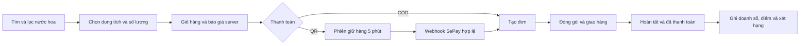
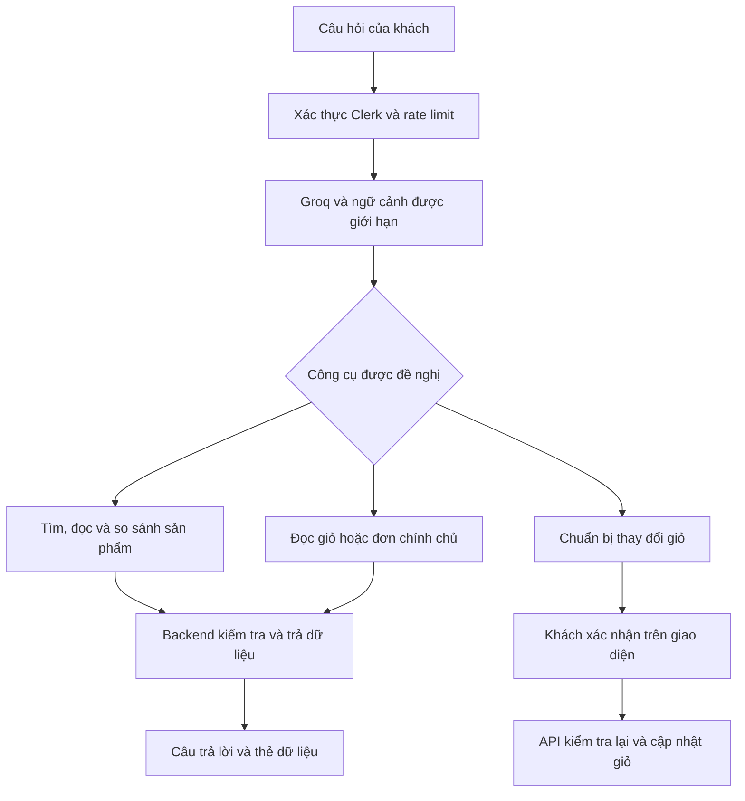
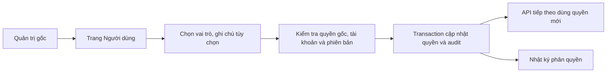

<div align="center">

[](client/package.json)
[](client/vite.config.js)
[](server/server.js)
[](server/models)
[](client/package.json)
[](server/middleware/authMiddleware.js)
[](server/config/cloudinary.js)
[](server/controllers/aiController.js)
[](https://velours-jet.vercel.app)

# 🌸 Velours — Perfume E-commerce Platform

**Khám phá hương thơm · Mua sắm trực tuyến · Tận hưởng đặc quyền thành viên**

[🌐 Website](https://velours-jet.vercel.app) · [⚙️ Backend API](https://vouges-backend.vercel.app) · [📖 Báo cáo dự án](BAO_CAO_DU_AN_VELOURS.md)

</div>

> Website thương mại điện tử nước hoa kết hợp thư viện kiến thức, trợ lý mua sắm AI và chương trình thành viên bốn hạng. Được xây dựng bằng React, Express và MongoDB.

<div align="center">

| 👥 Dành cho ai? | ✨ Điểm nổi bật | 🔧 Nền tảng kỹ thuật |
|:---:|:---:|:---:|
| Khách yêu nước hoa và cửa hàng cần quản lý bán hàng trực tuyến | Thư viện hương, chatbot có công cụ, loyalty và quản trị tập trung | React SPA, REST API, MongoDB transaction, webhook và SSE |

</div>

---

## 🧭 Mục lục

- [Tổng quan ứng dụng](#tong-quan)
- [Tính năng](#tinh-nang)
- [Luồng hoạt động](#luong-hoat-dong)
- [Công nghệ sử dụng](#cong-nghe)
- [Bắt đầu với dự án](#bat-dau)
- [Tổng quan cơ sở dữ liệu](#co-so-du-lieu)
- [Các kỹ thuật chính](#ky-thuat)
- [Kiểm thử và build](#kiem-thu)
- [Triển khai](#trien-khai)
- [Vấn đề thường gặp](#xu-ly-su-co)
- [Hướng phát triển](#huong-phat-trien)
- [Tra cứu nhanh](#tham-chieu)

---

<a id="tong-quan"></a>
## 🤔 Velours là gì?

**Một cửa hàng nước hoa trực tuyến gắn kết mua sắm, kiến thức và chăm sóc khách hàng.**

Khách hàng có thể tìm nước hoa theo thương hiệu, giới tính, dung tích, nồng độ và thuộc tính hương; đọc kiến thức trước khi chọn sản phẩm; thanh toán COD hoặc QR; theo dõi đơn và tích điểm đổi quà.

Với cửa hàng, Velours cung cấp dashboard để quản lý catalog, biến thể, tồn kho, đơn hàng, người dùng, ưu đãi và hội thoại hỗ trợ.

### Những khái niệm chính

| Khái niệm | Ý nghĩa trong Velours |
|---|---|
| **Biến thể sản phẩm** | Một dung tích cụ thể có giá, ảnh và tồn kho tương ứng |
| **Thư viện hương** | Nhóm hương, kiểu mùi và note hương, liên kết với sản phẩm sử dụng |
| **Loyalty** | Chương trình hạng thành viên, điểm thưởng, đổi quà và đặc quyền |
| **Ledger** | Sổ ghi từng lần cộng, trừ hoặc điều chỉnh điểm |
| **FEFO** | Điểm của lô hết hạn sớm nhất được sử dụng trước |
| **Quản trị gốc** | Tài khoản thuộc danh sách email cấu hình phía server, được bảo vệ và có quyền cấp/thu hồi Admin |
| **Tool calling** | AI đề nghị gọi công cụ; backend kiểm tra quyền và lấy dữ liệu thực tế trước khi trả lời |

### 🎯 Kiến thức và kỹ thuật áp dụng

- ✅ React với component, hook, context, lazy route và giao diện responsive.
- ✅ Express REST API tách route, middleware, controller, service và model.
- ✅ Clerk authentication, phân quyền nghiệp vụ và bảo vệ dữ liệu chính chủ.
- ✅ Transaction, cập nhật có điều kiện và chống xử lý trùng.
- ✅ Webhook thanh toán QR, phiên giữ hàng và email sau commit.
- ✅ AI có công cụ đọc dữ liệu và bước xác nhận hành động.
- ✅ Điểm theo lô, doanh số 12 tháng, đổi quà và nhật ký quản trị.

---

<a id="tinh-nang"></a>
## ✨ Tính năng

### 🛍️ Dành cho khách hàng

| Tính năng | Mô tả |
|---|---|
| 🔎 **Tìm kiếm và bộ lọc** | Lọc nhiều tiêu chí, khoảng giá, sắp xếp và phân trang nước hoa nam, nữ, unisex |
| 🧴 **Chi tiết sản phẩm** | Xem ảnh, thuộc tính hương, đánh giá và giá theo dung tích |
| 🛒 **Giỏ hàng** | Thêm sản phẩm, đổi dung tích, sửa số lượng và kiểm tra tồn |
| 🔐 **Tài khoản** | Đăng nhập qua Clerk; quản lý hồ sơ, sinh nhật và địa chỉ |
| 💳 **Thanh toán** | COD hoặc QR chuyển khoản qua SePay; voucher và lựa chọn giao hàng |
| 📦 **Theo dõi đơn** | Đơn cá nhân, thông tin thanh toán/giao hàng và email xác nhận |
| ⭐ **Đánh giá sau mua** | Tạo hoặc sửa đánh giá khi có đơn đã giao đủ điều kiện |
| 📚 **Thư viện kiến thức** | Nhóm hương, kiểu mùi, note hương và sản phẩm sử dụng |
| 🤖 **Trợ lý AI** | Tìm, so sánh sản phẩm, đọc giỏ/đơn chính chủ và đề xuất thay đổi giỏ |
| 💬 **Hỗ trợ trực tiếp** | Hội thoại với nhân viên, số chưa đọc và cập nhật qua SSE |

### 👑 Thành viên và ưu đãi

Trang thành viên có hai tab **Thành viên** và **Mã giảm giá**. Chương trình được khởi tạo với bốn hạng:

| Hạng | Doanh số hợp lệ trong 12 tháng | Điểm trên 1 triệu đồng hợp lệ | Màu nhận diện |
|---|---:|---:|---|
| Signature | Từ 0 đồng | 10 | Champagne |
| Prestige | Từ 15 triệu đồng | 12 | Emerald |
| Elite | Từ 40 triệu đồng | 15 | Sapphire |
| Private Circle | Từ 100 triệu đồng | 20 | Obsidian & Gold |

> Các ngưỡng và tỷ lệ trên là **giá trị khởi tạo**. Admin có thể điều chỉnh chính sách, quyền lợi và điều kiện áp dụng.

- Nâng hạng ngay khi đạt ngưỡng, có thể vượt nhiều hạng cùng lúc.
- Xét doanh số 12 tháng gần nhất; không tự hạ hạng giữa chu kỳ chỉ vì giao dịch cũ ra khỏi cửa sổ xét.
- Điểm độc lập với doanh số, có thời hạn, lịch sử và nguồn phát sinh; điều chỉnh khi hoàn trả.
- Đổi quà theo điểm, hạng, tồn và giới hạn; tiêu điểm theo FEFO.
- Chiến dịch sinh nhật, nâng hạng, tri ân, ra mắt và ưu đãi cá nhân theo cấu hình.

Quà và dịch vụ chỉ khả dụng khi đáp ứng điều kiện và tồn kho thực tế; dữ liệu mẫu không đồng nghĩa cửa hàng đã có sẵn quà hoặc sự kiện.

### 🧑‍💼 Dành cho quản trị viên

| Tính năng | Mô tả |
|---|---|
| 📊 **Dashboard** | Tổng quan catalog, đơn hàng, doanh thu và chỉ số vận hành |
| 📝 **Sản phẩm** | Thêm/sửa, quản lý biến thể, giá, tồn, ảnh và xuất bản |
| 🗂️ **Catalog** | Danh mục, thương hiệu và thư viện hương |
| 📋 **Đơn hàng** | Tra cứu, xem chi tiết và cập nhật tiến độ |
| 👥 **Người dùng** | Xem khách hàng/Admin, tìm kiếm, lọc vai trò và sửa hồ sơ khách |
| 🛡️ **Phân quyền** | Quản trị gốc cấp/thu hồi Admin, lý do không bắt buộc và luôn lưu nhật ký |
| 🎟️ **Voucher** | Mã cố định/phần trăm, thời hạn, điều kiện và lượt sử dụng |
| 🎁 **Loyalty & VIP** | Chính sách hạng, quà, chiến dịch, yêu cầu đổi và điều chỉnh có audit |
| 📨 **Hộp thư** | Phản hồi khách và quản lý trạng thái hội thoại |

### ⚙️ Đặc điểm kỹ thuật

| Kỹ thuật | Cách áp dụng | Giá trị |
|---|---|---|
| **Transaction** | Tạo đơn, giữ hàng, đổi quà, thay đổi quyền kèm audit | Giữ dữ liệu liên quan nhất quán |
| **Idempotency** | ID giao dịch, request ID, phiên bản và unique index | Chống webhook hoặc thao tác lặp |
| **Dữ liệu chính chủ** | Danh tính lấy từ xác thực backend | Khách chỉ đọc/sửa dữ liệu của mình |
| **Snapshot đơn** | Lưu tên, ảnh, dung tích và giá lúc mua | Catalog thay đổi không viết lại lịch sử đơn |
| **SSE** | Truyền cập nhật hội thoại | Cập nhật tin và trạng thái chưa đọc |
| **Tối ưu tải** | Chia bundle, lazy route, projection, cache và phân trang | Giảm dữ liệu/code phải tải |

---

<a id="luong-hoat-dong"></a>
## 🔄 Luồng hoạt động

### Luồng mua hàng



Phiên QR còn có nhánh hủy/hết hạn và xử lý giao dịch cần kiểm tra. Backend tính lại giá, tồn và voucher; trình duyệt không tự xác nhận thanh toán.

### Kiến trúc trợ lý AI



AI không được tuyên bố giỏ đã thay đổi chỉ dựa trên một đề xuất.

Ngân sách hỗ trợ số có dấu phân cách, chữ và dạng rút gọn như `1tr5`, “một triệu rưỡi”, “one hundred US dollars”. Với ngoại tệ, backend lấy tỷ giá tham khảo từ [Frankfurter](https://frankfurter.dev/), quy đổi sang VND rồi lọc sản phẩm; câu trả lời hiển thị nguồn và ngày tỷ giá. Ký hiệu mơ hồ cần được làm rõ; khi không có tỷ giá đủ mới, AI không tự đoán. Giá bán và thanh toán vẫn bằng VND.

### Cấp và thu hồi quyền Admin



Email trong `ADMIN_EMAILS` là quản trị gốc được bảo vệ. Admin được cấp trên website lưu quyền trong MongoDB và chỉ quản lý nghiệp vụ, không được tự cấp thêm Admin. Giao diện kiểm tra lại quyền khi quay lại tab hoặc gặp lỗi quyền truy cập.

Quản trị gốc có thể sửa họ tên, số điện thoại và ngày sinh của mọi tài khoản, bao gồm cả hai tài khoản quản trị gốc, tại **Người dùng → Chỉnh sửa → Thông tin**. Email đăng nhập không sửa tại đây; vai trò quản trị gốc vẫn khóa. Admin được cấp chỉ được sửa hồ sơ khách hàng.

---

<a id="cong-nghe"></a>
## 🧰 Công nghệ sử dụng

| Lớp | Công nghệ | Vai trò |
|---|---|---|
| Frontend | React 19, Vite 8, React Router | SPA, điều hướng và build |
| Giao diện | Tailwind CSS 4, CSS riêng, Lucide | Layout responsive và thành phần dùng chung |
| Backend | Node.js, Express 5, ES Modules | REST API và nghiệp vụ |
| CSDL | MongoDB, Mongoose 9 | Schema, index, truy vấn và transaction |
| Xác thực | Clerk, Svix | Đăng nhập và xác minh webhook danh tính |
| Ảnh | Cloudinary, Multer | Tiếp nhận, lưu và phân phối ảnh |
| Thanh toán | COD, SePay | Chuyển khoản QR và webhook |
| Email | Nodemailer, SMTP relay | Thư xác nhận đơn |
| AI / hỗ trợ | Groq tool calling, REST API, SSE | Tư vấn và hội thoại |
| Nội dung / thống kê | Tiptap, Recharts, Swiper | Biên tập, biểu đồ và thành phần trượt |
| Kiểm tra | Node Test Runner, ESLint, QA trình duyệt | Kiểm thử nghiệp vụ và giao diện |
| Hosting | Vercel | Frontend tĩnh, backend function và cron |

Phiên bản chi tiết được quản lý trong [client/package.json](client/package.json), [server/package.json](server/package.json) và các lockfile.

---

<a id="bat-dau"></a>
## 🚀 Bắt đầu với dự án

### Điều kiện môi trường

- **Node.js** đáp ứng yêu cầu Vite: `^20.19.0 || >=22.12.0`, cùng npm tương thích.
- **MongoDB hỗ trợ transaction**, chẳng hạn Atlas hoặc replica set.
- **Clerk** cho xác thực, **Cloudinary** cho luồng upload ảnh.
- **SePay, Groq, SMTP** để sử dụng các tích hợp tương ứng.
- **Vercel CLI** và quyền vào đúng project nếu triển khai lên môi trường hiện tại.

### 1. Cài dependency

Từ gốc dự án:

```powershell
cd server
npm ci
cd ../client
npm ci
```

### 2. Cấu hình frontend

Thiết lập `client/.env`:

```dotenv
VITE_BACKEND_URL=http://localhost:3000
VITE_CLERK_PUBLISHABLE_KEY=<clerk-publishable-key>
```

### 3. Cấu hình backend

Thiết lập `server/.env` với các nhóm biến:

| Nhóm | Biến môi trường |
|---|---|
| Server và CSDL | `PORT`, `MONGO_URI` |
| Clerk | `CLERK_PUBLISHABLE_KEY`, `CLERK_SECRET_KEY`, `CLERK_WEBHOOK_SECRET` |
| Quản trị gốc | `ADMIN_EMAILS` — email phân cách dấu phẩy; hỗ trợ `ADMIN_EMAIL` cũ |
| Cloudinary | `CLDN_NAME`, `CLDN_API_KEY`, `CLDN_API_SECRET` |
| SePay | `SEPAY_BANK_CODE`, `SEPAY_ACCOUNT_NUMBER`, `SEPAY_ACCOUNT_NAME`, `SEPAY_WEBHOOK_API_KEY` |
| AI | `GROQ_API_KEY`, `AI_MODEL`, `AI_FALLBACK_MODELS`, `AI_RATE_LIMIT_PER_MINUTE`, `AI_RATE_LIMIT_PER_DAY` |
| SMTP | `SMTP_USER`, `SMTP_PASS`, `SMTP_SENDER_EMAIL` |
| Tác vụ định kỳ | `CRON_SECRET` |

> 🔐 Giữ `.env` ngoài Git. Biến `VITE_` được đưa vào bundle trình duyệt; khóa bí mật và URI CSDL chỉ cấu hình phía server.

### 4. Kết nối các dịch vụ

| Dịch vụ | Thiết lập cần có |
|---|---|
| **MongoDB** | URI đúng database, môi trường hỗ trợ transaction |
| **Clerk** | Frontend/backend cùng ứng dụng; webhook `/api/clerk` và signing secret phù hợp |
| **Cloudinary** | Cloud name, API key và secret của tài khoản dùng cho dự án |
| **SePay** | Tài khoản nhận tiền và webhook `/api/orders/sepay-webhook` với API key đúng |
| **Groq** | API key và model được hỗ trợ; model chính lấy từ `AI_MODEL`. Khi Groq trả 429, chatbot thử các model trong `AI_FALLBACK_MODELS` (phân cách bằng dấu phẩy); mặc định là `openai/gpt-oss-120b,qwen/qwen3.8-27b`. Fallback chỉ giúp nếu model khác còn quota; giới hạn toàn tổ chức vẫn cần chờ reset. |
| **Chatbot** | Câu hỏi thường gặp được trả lời tại server mà không gọi Groq. Lượt cần AI mặc định giới hạn 8 lần/phút và 50 lần/ngày mỗi tài khoản; điều chỉnh bằng `AI_RATE_LIMIT_PER_MINUTE` và `AI_RATE_LIMIT_PER_DAY`. Quota của Groq vẫn áp dụng riêng. |
| **SMTP** | Thông tin đăng nhập relay, địa chỉ gửi được phép sử dụng |

Webhook từ dịch vụ ngoài cần URL HTTPS truy cập được; localhost riêng không tự nhận webhook từ Internet.

### 5. Chuẩn bị dữ liệu và quyền quản trị

Database mới cần dữ liệu được phục hồi hợp lệ hoặc thêm qua Admin. Cài dependency không tự phục hồi catalog đang vận hành.

1. Cấu hình email quản trị gốc trong `ADMIN_EMAILS` phía backend.
2. Đăng nhập bằng tài khoản Clerk tương ứng và vào `/owner`.
3. Với tài khoản khác đã đăng ký, mở **Người dùng → Chỉnh sửa → Phân quyền** để cấp/thu hồi Admin, có thể nhập lý do tối đa 500 ký tự rồi xác nhận. Lý do không bắt buộc. Thông tin hồ sơ và quyền được quản lý trong cùng cửa sổ chỉnh sửa; nhật ký tiếp tục lưu ở backend.

Chi tiết khởi tạo danh mục và loyalty nằm trong Chương IV của [báo cáo dự án](BAO_CAO_DU_AN_VELOURS.md).

### 6. Khởi động ứng dụng

Terminal backend, bắt đầu từ gốc dự án:

```powershell
cd server
npm run server
```

Terminal frontend, cũng bắt đầu từ gốc dự án:

```powershell
cd client
npm run dev
```

Mở URL Vite in ra, thường là **http://localhost:5173**. Backend mặc định tại **http://localhost:3000**; `npm start` trong `server/` chạy không qua nodemon.

---

<a id="co-so-du-lieu"></a>
## 📊 Tổng quan cơ sở dữ liệu

Dữ liệu nghiệp vụ lưu trong MongoDB. Schema và index nằm tại [server/models/](server/models).

### Sản phẩm và đơn hàng

| Model | Trường/nhóm dữ liệu | Mục đích |
|---|---|---|
| `Product` | `title`, `category`, `brand`, `gender`, `concentration`, `fragrance` | Thông tin nước hoa và thuộc tính tra cứu |
| `Product` — biến thể | `sizes`, `price`, `stockBySize`, `inStockBySize`, `sizeImages` | Giá, tồn, trạng thái và ảnh theo dung tích |
| `Product` — hiển thị | `images`, `isPublished`, `isDeleted`, `inventoryMode` | Ảnh, xuất bản, xóa mềm và chế độ tồn |
| `Category` | `name`, `nameKey`, `types`, `storefrontVisible` | Danh mục và loại sản phẩm |
| `Order` | `userId`, `items`, `address`, `status`, `paymentMethod`, `isPaid` | Chủ đơn, snapshot dòng hàng và tiến độ |
| `Order` — tiền | `subtotal`, `shipping`, `discount`, `amount` | Tiền hàng, phí, giảm giá và tổng VND |
| `Order` — QR | `paymentCode`, `qrAmount`, `transactionId`, `paymentExpiresAt` | Phiên thanh toán, chống ghi nhận trùng |
| `Review` | `productId`, `userId`, `rating`, `comment` | Đánh giá có điều kiện sau mua |

### Người dùng, nội dung và khuyến mại

| Model | Vai trò |
|---|---|
| `User`, `Address` | Danh tính, hồ sơ, giỏ, địa chỉ và quyền Admin được cấp |
| `UserAccessAudit` | Người thực hiện, lý do, phiên bản và lịch sử cấp/thu hồi quyền |
| `FragranceTerm` | Thương hiệu, nhóm hương, kiểu mùi, note và nội dung có cấu trúc |
| `Voucher`, `VoucherUse` | Điều kiện ưu đãi, giới hạn và lượt sử dụng |
| `CatalogSource`, `CatalogMigration` | Nguồn dữ liệu và đợt chuyển đổi |
| `SupportConversation`, `SupportMessage` | Hội thoại, thứ tự tin, trạng thái và số chưa đọc |
| `AIUsage`, `AIToolAudit`, `SupportUsage` | Giới hạn sử dụng và truy vết AI/hỗ trợ |

### Thành viên và điểm thưởng

| Nhóm model | Vai trò |
|---|---|
| `LoyaltyConfig`, `LoyaltyAccount` | Chính sách, hạng, ngày hiệu lực và trạng thái tài khoản |
| `LoyaltyOrder` | Doanh số và điểm ghi nhận cho từng đơn |
| `LoyaltyLot`, `LoyaltyLedger` | Lô điểm, hạn dùng và giao dịch cộng/trừ/điều chỉnh |
| `LoyaltyTierHistory`, `LoyaltyAudit` | Lịch sử hạng và thay đổi quản trị |
| `LoyaltyReward`, `LoyaltyRedemption` | Quà, tồn và yêu cầu đổi |
| `LoyaltyCampaign`, `LoyaltyClaim` | Chiến dịch và quyền lợi đã cấp |
| `LoyaltyNotification`, `LoyaltyJob` | Thông báo và checkpoint bảo trì |

---

<a id="ky-thuat"></a>
## 🔧 Các kỹ thuật chính

### Giá và tồn kho do backend quyết định

Giá, dung tích, tồn và voucher được kiểm tra lại trước khi tạo đơn. Dòng hàng lưu snapshot để lần sửa catalog sau đó không làm thay đổi đơn cũ. Các thao tác cần đồng bộ nhiều tài liệu dùng transaction và kiểm tra trạng thái/phiên bản.

### Điểm thưởng tách khỏi doanh số xét hạng

```text
points = floor(eligible_amount_vnd × tier_rate / 1.000.000)
```

Tiền hàng hợp lệ không gồm phí giao và được điều chỉnh khi hoàn trả. Đơn gây nâng hạng nhận điểm theo hạng trước đó; tỷ lệ mới áp dụng cho đơn tiếp theo. Khi đổi quà, tiêu lô hết hạn sớm nhất và hoàn đúng nguồn nếu hủy hợp lệ.

### Phân quyền có truy vết

Quyền Admin lưu trong `User.adminAccess`; backend tính quyền hiệu lực từ quản trị gốc và quyền cấp trong database. Thay đổi quyền và audit commit cùng transaction. Request ID chống lặp; phiên bản ngăn thao tác trên dữ liệu cũ ghi đè thay đổi mới.

### AI có công cụ trong phạm vi cho phép

Chatbot đọc dữ liệu qua công cụ server, ràng buộc giỏ/đơn với người đăng nhập. Công cụ `prepare...` chỉ tạo đề xuất; thao tác thực tế cần xác nhận và kiểm tra lại ở API giỏ.

### Hội thoại cập nhật qua SSE

Tin nhắn có thứ tự server và `clientMessageId` chống gửi trùng. SSE truyền thay đổi cho khách/nhân viên có quyền trong hội thoại, đồng thời mỗi API vẫn kiểm tra quyền đọc/gửi.

---

<a id="kiem-thu"></a>
## 🧪 Kiểm thử và build

Trong `client/`:

```powershell
npm run lint
npm run build
npm run preview
```

Trong `server/`:

```powershell
npm test
npm run test:tools
```

Tập kiểm tra chọn lọc: `npm run test:ai`, `npm run test:library`. QA trình duyệt nằm tại [perfumeBrowserQA.mjs](server/scripts/perfumeBrowserQA.mjs).

> 📌 Đợt kiểm tra ngày **03/11/2026** ghi nhận **576 test ứng dụng + 56 test công cụ đạt**, cùng lint/build và QA trang Người dùng trên năm kích thước. Đây là kết quả của phiên bản tương ứng, không phải badge CI cập nhật tự động.

`client/dist/` là đầu ra sinh tự động; build trước khi preview. Test sử dụng fixture phù hợp, không đại diện cho từng ấy lượt mua hoặc thanh toán thật.

---

<a id="trien-khai"></a>
## 🚢 Triển khai

### Đóng gói backend

Từ gốc dự án:

```powershell
node tools/deploy/prepare-backend.mjs
```

Script đưa tiện ích dùng chung từ frontend vào function root và kiểm tra import. Artifact được tạo tại `.deploy-media-backend/`.

### Đóng gói frontend

Trong `client/`:

```powershell
npm run build:artifact -- --backend=https://vouges-backend.vercel.app
```

Artifact frontend dùng Build Output API tại `.deploy-media-frontend/`.

### Phát hành lên Vercel

Từ gốc dự án, với đúng tài khoản/project đã cấu hình:

```powershell
vercel deploy --prod --skip-domain --yes --project vouges-backend --cwd .deploy-media-backend
vercel deploy --prebuilt --archive=tgz --prod --skip-domain --yes --project velours --cwd .deploy-media-frontend
```

Kiểm tra deployment trước khi promote lên domain chính:

```powershell
vercel curl <deployment-url>/ --yes --scope ixi4
```

`--skip-domain` yêu cầu promote riêng để cập nhật alias chính; `--archive=tgz` giúp giảm lượt upload tệp. Cấu hình môi trường riêng cho frontend/backend, origin Clerk và URL webhook theo môi trường phát hành.

### 🖼️ Vận hành ảnh Cloudinary

<details>
<summary>Xem checkpoint và lệnh tiếp tục chuyển ảnh</summary>

Theo [checkpoint ngày 01/11/2026](data/cloudinary-migration-2026-11-01/completion.json), đã ánh xạ 9.443 URL ảnh; kế hoạch còn 12.651 tệp local. Đây là số liệu checkpoint, không phải quota tài khoản hiện thời.

Dự án giữ gói Free và chia đợt. Giữ `data/cloudinary-migration-2026-11-01/`, `.backups/cloudinary-migration-2026-11-01/` và ảnh đang dùng trong `client/public/` để tiếp tục, kiểm tra hoặc hoàn tác.

Chạy trong `server/` khi quota cho phép:

```powershell
npm run media:migrate -- status
npm run media:migrate -- upload --scope=local --concurrency=8
npm run media:migrate -- verify --concurrency=24
npm run media:migrate -- apply --apply --database=vouges
npm run media:migrate -- audit
```

Uploader mặc định dừng ở 90% credits và không tự nâng cấp tài khoản. Hoàn tác một nhóm theo backup:

```powershell
npm run media:migrate -- rollback --apply --database=vouges --batch=<ten-backup.json>
```

</details>

---

<a id="xu-ly-su-co"></a>
## 🐛 Vấn đề thường gặp

| Hiện tượng | Điểm cần kiểm tra |
|---|---|
| Frontend không gọi được API | `VITE_BACKEND_URL`, backend và origin/môi trường đang dùng |
| Không mở được đăng nhập | Publishable key, cấu hình Clerk và domain được phép |
| Đăng nhập nhưng không thấy dashboard | Quản trị gốc dùng đúng email cấu hình; tài khoản khác cần được cấp Admin |
| Không thấy mục Phân quyền trong Chỉnh sửa | Chỉ quản trị gốc được cấp/thu hồi Admin cho tài khoản không được bảo vệ |
| Transaction MongoDB lỗi | CSDL hỗ trợ transaction, quyền kết nối, collection/index cần thiết |
| QR chưa được xác nhận | Hạn phiên, số tiền/nội dung chuyển, webhook URL và API key SePay |
| Đơn đã tạo nhưng chưa có email | SMTP, địa chỉ gửi và log; lỗi thư không xóa đơn đã commit |
| Chatbot lỗi hoặc báo giới hạn | Groq key/model, quota, rate limit và log công cụ |
| Upload/tải ảnh lỗi | Cloudinary, MIME/kích thước tệp, URL và ảnh local còn tham chiếu |
| URL chi tiết không mở trực tiếp | SPA rewrite và artifact domain đang phục vụ |
| Quyền đổi nhưng UI chưa cập nhật | Quay lại tab hoặc tải lại; backend kiểm tra ở yêu cầu tiếp theo |

---

<a id="huong-phat-trien"></a>
## 🏗️ Trạng thái và hướng phát triển

Catalog, giỏ, COD/QR, đơn hàng, thư viện, hỗ trợ, loyalty và phân quyền Admin đã có triển khai cùng kiểm thử. Những phần tiếp tục hoàn thiện:

- [ ] Nối backend cho form liên hệ và đăng ký bản tin.
- [ ] Bổ sung liên kết mạng xã hội thật và các mục footer còn là placeholder.
- [ ] Quản lý banner/menu động qua Admin.
- [ ] Tích hợp hãng vận chuyển và hoàn tiền ngân hàng.
- [ ] Phân quyền nhân viên theo nhiệm vụ: kho, hỗ trợ, marketing, kế toán.
- [ ] Hoàn tất chuyển ảnh theo quota Cloudinary Free.
- [ ] Mở rộng SEO nội dung động, giám sát và kiểm thử tải.

Phạm vi, giới hạn và thiết kế chi tiết có trong [báo cáo dự án](BAO_CAO_DU_AN_VELOURS.md).

---

<a id="tham-chieu"></a>
## 📚 Tra cứu nhanh

### Lệnh thường dùng

| Thư mục | Lệnh | Chức năng |
|---|---|---|
| `client/` | `npm run dev` | Frontend phát triển |
| `client/` | `npm run lint` | Kiểm tra ESLint |
| `client/` | `npm run build` | Build production |
| `client/` | `npm run preview` | Xem bản build |
| `server/` | `npm run server` | Backend qua nodemon |
| `server/` | `npm start` | Backend trực tiếp |
| `server/` | `npm test` | Kiểm thử core và AI |
| `server/` | `npm run test:tools` | Kiểm thử module/công cụ |
| `server/` | `npm run test:ai` | Tập kiểm thử AI |
| `server/` | `npm run test:library` | Tập kiểm thử thư viện |

### Cấu trúc thư mục

```text
vouges/
├── client/
│   ├── src/
│   │   ├── components/    Cửa hàng, thành viên và quản trị
│   │   ├── pages/         Trang khách và pages/owner/
│   │   ├── context/       Trạng thái ứng dụng, tài khoản, giỏ
│   │   ├── hooks/         Nạp dữ liệu và hành vi giao diện
│   │   ├── utils/         Tiện ích dùng chung
│   │   └── data/          Dữ liệu tĩnh frontend
│   ├── public/            Ảnh, font, tài nguyên công khai
│   └── scripts/           Đóng gói frontend
├── server/
│   ├── routes/            REST API
│   ├── middleware/        Xác thực, phân quyền, upload, rate limit
│   ├── controllers/       Request/response
│   ├── services/          Bán hàng, loyalty, AI, hỗ trợ
│   ├── models/            Schema và index Mongoose
│   ├── data/              Dữ liệu tĩnh cho API
│   ├── tests/             Kiểm thử core và AI
│   ├── scripts/           Kiểm tra và vận hành
│   └── server.js          Điểm khởi động backend
├── tools/                 Triển khai, xử lý ảnh, module và test
├── data/                  Fixture và checkpoint còn dùng
├── .backups/              Backup chuyển ảnh đang tiếp tục
├── BAO_CAO_DU_AN_VELOURS.md
└── README.md
```

Dữ liệu khách, đơn và giao dịch điểm nằm trong **MongoDB**. `server/data/` chứa dữ liệu tĩnh cho API; `data/` ở gốc chứa fixture, xác nhận quyền sử dụng nội dung và checkpoint. `vouges` là tên kỹ thuật được giữ trong một số cấu hình; thương hiệu là **Velours**.

### Các tệp và nhóm mã quan trọng

| Nội dung | Đường dẫn |
|---|---|
| Route giao diện | [App.jsx](client/src/App.jsx) |
| Trạng thái tài khoản/giỏ | [AppContext.jsx](client/src/context/AppContext.jsx) |
| Khởi động và API | [server.js](server/server.js), [routes](server/routes) |
| Xác thực và quyền | [authMiddleware.js](server/middleware/authMiddleware.js) |
| Người dùng | [Users.jsx](client/src/pages/owner/Users.jsx), [userAccess.js](server/services/userAccess.js) |
| Đơn, COD/QR và webhook | [orderController.js](server/controllers/orderController.js) |
| Chatbot và công cụ | [aiController.js](server/controllers/aiController.js), [AI tools](server/services/ai/tools) |
| Thành viên và điểm | [Loyalty services](server/services/loyalty), [Loyalty models](server/models/Loyalty.js) |
| Thư viện kiến thức | [Knowledge.jsx](client/src/pages/Knowledge.jsx), [libraryController.js](server/controllers/libraryController.js) |
| QA trình duyệt | [perfumeBrowserQA.mjs](server/scripts/perfumeBrowserQA.mjs) |
| Đóng gói | [Frontend](client/scripts/prepare-vercel-artifact.mjs), [Backend](tools/deploy/prepare-backend.mjs) |
| Phân tích và thiết kế | [BAO_CAO_DU_AN_VELOURS.md](BAO_CAO_DU_AN_VELOURS.md) |

---

<div align="center">

**VELOURS · Khám phá dấu ấn hương thơm của riêng bạn**

[Website](https://velours-jet.vercel.app) · [Backend API](https://vouges-backend.vercel.app) · [Báo cáo dự án](BAO_CAO_DU_AN_VELOURS.md)

</div>
