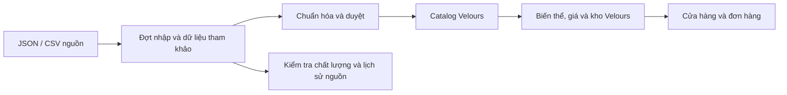

# Đề xuất dashboard Velours chuyên nước hoa

Ngày: 27/10/2026. Đây là **bản thiết kế ban đầu** được lưu để tham khảo. Yêu cầu sau đó đã chuyển sang dùng Apaniche làm catalog thật và đặt hàng theo trạng thái nguồn. Xem [triển khai hiện tại, kết quả nhập và hướng dẫn vận hành](./PERFUME_CATALOG.md); các giả định staging và đơn vị tiền cũ trong tài liệu dưới đây đã được thay thế.

## 1. Những gì đang có

Dashboard hiện tại có tổng quan, sản phẩm/biến thể, danh mục, đơn hàng nằm trong tổng quan, voucher và tin nhắn. Model Product đã quản lý giá, tồn kho, trạng thái và ảnh theo size; chưa có model riêng cho hãng, hệ thống phân loại hương, nguồn dữ liệu và quá trình duyệt.

Nguồn hiện có: [bộ dữ liệu Apaniche](../data/research/apaniche/README.md), gồm 2.444 sản phẩm, 5.289 biến thể và 11.290 URL ảnh. Trong đó 2.293 sản phẩm có dữ liệu tầng hương và 2.332 có nhóm mùi chính. Có 102 cảnh báo chất lượng; một sản phẩm có thể có nhiều cảnh báo.

Khoảng trống cần xử lý:

- 172 trang chi tiết thiếu trường hãng, 138 thiếu xuất xứ, 254 thiếu nồng độ, 123 thiếu nhóm hương, 151 thiếu tầng hương và 2 bản ghi không có ảnh chung từ API.
- Các con số đánh giá có nguồn gốc/phương pháp chưa được xác minh, một số có giá trị âm hoặc vượt 100%.
- Toàn bộ dữ liệu không chỉ gồm nước hoa. Kiểm tra tên phát hiện 49 bản ghi cần rà soát như nến, khử mùi, chăm sóc cơ thể hoặc set có phụ kiện. Đây là gợi ý kiểm duyệt bằng từ khóa, không phải kết luận loại bỏ tự động.
- Ba thư viện chưa có bộ nội dung hoàn chỉnh: tên/liên kết của 31 nhóm, 68 kiểu mùi và 609 note đã có trong sản phẩm; sitemap có 950 URL note.

## 2. Ba lớp dữ liệu cần quản lý

| Lớp | Câu hỏi nó trả lời | Người quyết định |
| --- | --- | --- |
| Dữ liệu tham khảo | Nguồn bên ngoài đang công bố thông tin gì? | Giữ bản gốc, ghi nguồn và thời gian |
| Catalog Velours | Velours bán sản phẩm nào và giới thiệu thế nào? | Chủ cửa hàng duyệt thông tin và xuất bản |
| Vận hành bán hàng | Giá bán thực, số lượng trong kho, đơn và thanh toán là gì? | Nghiệp vụ của Velours |

Giá nguồn có thể dùng để đối chiếu; giá bán là trường riêng. Trạng thái còn hàng của Apaniche không cung cấp số lượng tồn kho của Velours. Nhập dữ liệu nguồn tạo bản ghi tham khảo hoặc bản nháp; việc xuất bản và mở bán có điều kiện riêng.

## 3. Menu dashboard

| Mục | Nội dung chính |
| --- | --- |
| Tổng quan | Doanh thu/đơn thực tế, hàng sắp hết, việc cần xử lý, số bản ghi chờ duyệt |
| Sản phẩm | Catalog của Velours, bản nháp, đã xuất bản, ngừng bán |
| Giá và kho | Danh sách theo SKU, nhập/điều chỉnh kho, hàng có thể bán và phần đang giữ cho đơn |
| Đơn hàng | Tái sử dụng quy trình trạng thái, COD/QR và tổng quan đơn hiện tại |
| Nhập và duyệt dữ liệu | Xem 2.444 bản ghi tham khảo, chọn bản ghi phù hợp, đối chiếu và tạo bản nháp |
| Thương hiệu | Tên chuẩn, tên khác, logo, giới thiệu và sản phẩm liên quan |
| Thư viện hương | Ba khu riêng cho nhóm hương, kiểu mùi và note hương |
| Chất lượng dữ liệu | Thiếu trường, giá 0, liên kết ảnh, số liệu bất thường và trùng sản phẩm |
| Nội dung | Giới thiệu, bài tư vấn, SEO và lịch banner, bổ sung sau phần catalog |
| Khách hàng và thành viên | Dữ liệu khách, lịch sử mua và quyền lợi đã có, mở rộng theo nhu cầu |
| Ưu đãi và tin nhắn | Tận dụng voucher và chăm sóc khách hàng hiện tại |

Lịch sử thay đổi có thể đặt trong từng màn hình trước; chỉ tách thành menu riêng khi cần tìm kiếm xuyên hệ thống. Nếu vẫn một người quản trị, chưa cần dựng hệ thống phân quyền nhiều tầng ngay.

## 4. Màn hình tổng quan

Trang đầu là danh sách công việc và chỉ số có thể hành động:

- Đơn chờ xử lý, QR cần đối soát và đơn cần đóng/giao.
- SKU sắp hết, hết hàng và điều chỉnh kho chờ xác nhận.
- Sản phẩm chờ duyệt, thiếu thông tin bắt buộc, ảnh cần chọn lại.
- Biểu đồ doanh thu và sản phẩm bán tốt dựa trên giao dịch của Velours.
- Lối vào các đợt nhập, kết quả kiểm tra và thay đổi nguồn mới nhất.

Tách số lượng trong catalog tham khảo, số sản phẩm đã xuất bản và số SKU có thể mua. Độ đầy đủ của thông tin là chỉ số nội bộ, không diễn giải thành chất lượng mùi hương.

## 5. Danh sách và trang sửa sản phẩm

Danh sách dùng bảng với ảnh, tên, hãng, nồng độ, số biến thể, khoảng giá Velours, tồn có thể bán, trạng thái xuất bản và cảnh báo. Tìm theo tên/SKU; lọc theo hãng, đối tượng, nhóm hương, trạng thái và trường còn thiếu. Có lựa chọn hàng loạt, lưu bộ lọc thường dùng và xuất dữ liệu.

Form chi tiết nên có sáu tab:

| Tab | Trường và thao tác |
| --- | --- |
| Thông tin chung | Tên, hãng, dòng sản phẩm, nồng độ, xuất xứ, đối tượng, mô tả do Velours quản lý |
| Dung tích và bán hàng | SKU, dung tích ml, dạng bán, ảnh riêng, giá Velours, giá tham khảo, trạng thái bán |
| Hồ sơ mùi | Nhóm hương, các kiểu mùi chính, note đầu/giữa/cuối, ngữ cảnh phù hợp |
| Đánh giá trải nghiệm | Lưu/tỏa hương, mùa/ngày–đêm, nguồn, ngày đánh giá, trạng thái được phép hiển thị |
| Ảnh và nội dung | Ảnh đại diện/bộ ảnh, ảnh từng size, ảnh tham khảo và ảnh đã chọn cho cửa hàng |
| Xuất bản và lịch sử | Bản xem trước, thông tin còn thiếu, nguồn gốc từng trường, người sửa và thay đổi |

Một dòng nước hoa khác nồng độ có thể là sản phẩm khác: Eros EDT và Eros EDP không tự gộp theo tên gần giống. Một sản phẩm có nhiều SKU theo dung tích và dạng bán. Ví dụ `100 ml / nguyên chai` và `100 ml / tester` phải phân biệt được dù cùng dung tích.

Các chiều phân loại cần độc lập:

- Đối tượng sử dụng: nam, nữ, unisex.
- Nồng độ: EDC, EDT, EDP, parfum, extrait hoặc giá trị khác/chưa xác định.
- Dạng bán: nguyên chai, mini, chiết/dùng thử, tester; set quà được duyệt theo phạm vi kinh doanh.
- Hãng, nhóm hương, kiểu mùi và note là các danh mục liên kết riêng.

Niche/designer là thuộc tính phân loại, không phải dung tích. Giới tính cũng không phải nhánh con của thương hiệu. Các bộ lọc storefront dùng những chiều dữ liệu đã được chuẩn hóa này.

## 6. Nhập và duyệt bộ Apaniche

Quy trình cho mỗi đợt nhập:

1. Hiển thị nguồn, ngày lấy, số bản ghi và đơn vị giá.
2. Đánh dấu thuộc phạm vi nước hoa, cần xem lại hoặc loại khỏi đợt nhập, kèm lý do.
3. Chuẩn hóa hãng, nồng độ, dung tích, dạng bán và các danh mục hương. Giữ lại giá trị gốc để đối chiếu.
4. Phát hiện bản ghi đã nhập qua khóa `(nguồn, loại bản ghi, ID nguồn)`. Gợi ý sản phẩm tương tự để người quản trị quyết định; không tự gộp chỉ theo tên.
5. Xem bản so sánh nguồn – bản nháp Velours; chọn trường sẽ dùng.
6. Tạo bản nháp, bổ sung giá bán và nhập kho thực, chọn ảnh và thông tin được phép hiển thị.
7. Xem trước và xuất bản những sản phẩm đạt điều kiện.

Mỗi đợt có tiến độ, số thành công/lỗi/bỏ qua, tệp lỗi và nút tiếp tục. Nhập lại cùng nguồn phải tránh tạo bản sao. Khi cập nhật nguồn, giữ các trường đã được Velours sửa hoặc khóa; giá bán và tồn kho vận hành không bị ghi đè.

Điều kiện xuất bản tập trung vào định danh, hãng, dữ liệu bán hàng hợp lệ, ảnh đã chọn và tình trạng duyệt. Biểu đồ tùy chọn chưa được duyệt có thể ẩn, không nhất thiết chặn xuất bản toàn bộ sản phẩm. Sản phẩm hết hàng và sản phẩm chưa xuất bản là hai trạng thái khác nhau.

## 7. Giá, SKU và kho

Mỗi SKU cần có nhãn dễ đọc, dung tích số, dạng bán, giá bán, ảnh và trạng thái. Giữ nguyên lịch sử khi đổi tên hoặc ngừng bán một SKU đã có đơn.

Trên màn hình kho, hiển thị lượng thực, lượng đang giữ cho đơn và lượng có thể bán theo đúng định nghĩa của hệ thống. Trước khi thêm các cột này cần đối chiếu cách QR hiện tại đang trừ/hoàn tồn, để không trừ hai lần. Mọi điều chỉnh kho có số trước/sau, lý do và người thực hiện.

Nếu bán nước hoa chiết từ chai lớn, cần thống nhất thêm nghiệp vụ quản lý lượng ml và chuyển đổi từ chai nguồn sang đơn vị chiết. Nếu nhập sẵn từng chai 10 ml để bán, có thể tiếp tục quản lý theo số đơn vị SKU. Đây là lựa chọn vận hành cần chốt trước khi làm module chiết; không suy diễn từ nhãn “10 ml” trong dữ liệu tham khảo.

**Đơn vị giá:** dữ liệu Apaniche hiện là VND; hệ thống Velours hiện lưu nghìn đồng. Giai đoạn đầu giữ hợp đồng backend hiện tại và chuyển đổi đúng một lần tại bước nhập giá. Ví dụ 1.250.000 VND thành `1250` trong trường giá hiện tại. Giao diện vẫn hiển thị tiền đầy đủ. Giá 0 của nguồn phải được xem lại, không tự coi là hàng miễn phí.

## 8. Ba thư viện hương

| Thư viện | Trường cần quản lý | Liên kết sử dụng |
| --- | --- | --- |
| Nhóm hương | Tên Việt/Anh, slug, giải thích ngắn, trạng thái xuất bản | Danh mục lọc, trang kiến thức và sản phẩm |
| Kiểu mùi | Tên, giải thích, màu biểu đồ, trạng thái | Biểu đồ mùi chính và bộ lọc |
| Note hương | Tên Việt/Anh, tên khác, ảnh minh họa, thông tin nguồn gốc đã biên tập, trạng thái | Tầng đầu/giữa/cuối và trang thư viện |

Một note chỉ có một bản ghi chuẩn, được nhiều sản phẩm sử dụng. Vai trò đầu/giữa/cuối là thuộc tính của quan hệ giữa note với sản phẩm, không cố định cho note đó ở mọi chai.

Có thể nhập danh sách tên và liên kết đã có để tạo bản nháp thư viện trước. Phần mô tả/ảnh/nguồn gốc còn thiếu được hiển thị là chưa hoàn thiện. Chưa coi 950 URL note là 950 trang nội dung đã có đầy đủ.

## 9. Chất lượng và quyền sở hữu thông tin

Các nhóm cần lọc riêng:

- Thiếu hãng, xuất xứ, nồng độ, ảnh hoặc tầng hương.
- Nghi trùng sản phẩm nhưng khác nồng độ/dạng bán.
- Giá nguồn 0, khoảng giá khác các biến thể hoặc thiếu dữ liệu biến thể.
- Chỉ số âm, vượt 100%, nguồn/phương pháp chưa xác minh.
- Bản ghi ngoài phạm vi kinh doanh, ảnh tham khảo chưa được chọn.

Mỗi vấn đề có trạng thái chưa xử lý, đang xử lý, đã sửa hoặc chấp nhận có lý do. Giữ cả giá trị nguồn và giá trị Velours đã duyệt. Không thay 1100% thành 100% một cách ngầm định. Các cột xuất xứ dữ liệu giúp phân biệt thông tin tham khảo, biên tập của cửa hàng và bình chọn thật của khách.

Việc có ghi nguồn không thay thế bước duyệt để hiển thị công khai. Các biểu đồ được quản lý bằng trạng thái duyệt riêng; chưa duyệt thì ẩn hoặc chỉ xuất hiện trong dashboard.

## 10. Mở rộng backend theo từng bước

Các thực thể cần bổ sung về mặt logic:

| Thực thể | Trách nhiệm |
| --- | --- |
| ImportBatch | Nguồn, thời gian, tiến độ, tổng số và lỗi |
| CatalogSourceRecord | Dữ liệu tham khảo, ID nguồn, liên kết nguồn, cảnh báo, ánh xạ tới sản phẩm Velours |
| Brand | Hãng chuẩn và tên thay thế |
| FragranceGroup / Accord / ScentNote | Các danh mục hương dùng chung |
| Product mở rộng | Hồ sơ nước hoa, liên kết hãng/thư viện, trạng thái xuất bản và duyệt |
| Variant metadata | Mã SKU ổn định, dung tích, dạng bán, liên kết với size key đang dùng |
| Audit / StockAdjustment | Ai sửa gì, lý do và thay đổi vận hành |

Giai đoạn đầu có thể bổ sung metadata biến thể theo size key trong Product để tiếp tục dùng `price`, `stockBySize`, `inStockBySize` và `sizeImages`. Tách Variant thành collection riêng là một migration tiếp theo khi nghiệp vụ cần, không đổi đồng thời với toàn bộ quy trình mua hàng.

Các ràng buộc chuyển đổi:

- Tái sử dụng CRUD, kiểm tra giá/tồn, bảo vệ đổi tên size khi có đơn QR, kiểm tra phiên bản và transaction hiện tại.
- Giữ nguyên snapshot tên/giá/ảnh của đơn đã tạo. Sản phẩm mỹ phẩm cũ có thể ngừng xuất bản nhưng không xóa dấu vết đơn hàng.
- Bổ sung bộ lọc xuất bản cho API storefront và các công cụ AI; bản nháp/tham khảo chỉ được quản trị viên truy cập.
- API công khai trả các trường phục vụ khách hàng; dữ liệu nội bộ như ghi chú duyệt, lịch sử và giá vốn nếu có dùng endpoint được phân quyền riêng.
- Danh sách lớn cần tìm/lọc/phân trang ở server; chỉ tải chi tiết hồ sơ, biểu đồ và lịch sử khi mở sản phẩm.
- Dùng `_id` của Velours cho đơn/giỏ; ID Apaniche là khóa tham chiếu nguồn riêng.
- Logic màu khung sản phẩm hiện tại tiếp tục được giữ.

## 11. Thứ tự làm đề xuất

**Đợt 1 — Nắm và chuẩn hóa dữ liệu:** màn hình nhập/duyệt, kho tham khảo, bộ lọc lỗi, hãng và danh mục hương cơ bản. Hoàn thành khi xem/lọc được toàn bộ 2.444 bản ghi, tìm được mọi cảnh báo và nhập lại không tạo bản sao.

**Đợt 2 — Tạo catalog bán thật:** form sản phẩm nước hoa, SKU/dung tích/dạng bán, giá/kho Velours, trạng thái bản nháp/xuất bản và xem trước. Hoàn thành khi có thể chọn một nhóm sản phẩm đã duyệt và mua được bằng COD/QR với logic hiện tại.

**Đợt 3 — Đồng bộ storefront:** menu nước hoa, bộ lọc hãng/nồng độ/hương, trang chi tiết và thư viện chỉ lấy nội dung đã duyệt. Sản phẩm cũ ngoài phạm vi được ngừng xuất bản có kiểm soát.

**Đợt 4 — Tối ưu vận hành:** báo cáo theo SKU/hãng, điều chỉnh kho, nội dung tư vấn, cập nhật nguồn theo trường và mở rộng phân quyền nếu có thêm nhân viên.

Ưu tiên đợt 1 và 2 trước khi xuất bản catalog lớn. Các thông tin cần chốt khi triển khai sâu hơn là: có tự chiết từ chai lớn không, có bán set kèm sản phẩm chăm sóc cơ thể không và danh mục nào thực sự sẽ nhập hàng.
